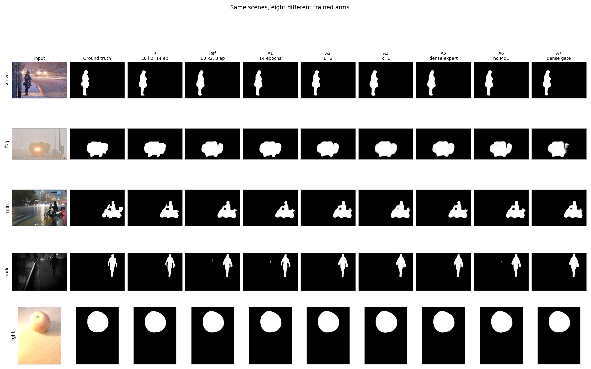
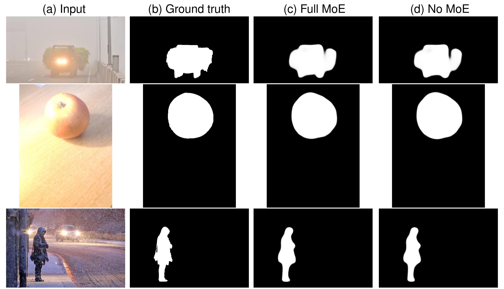
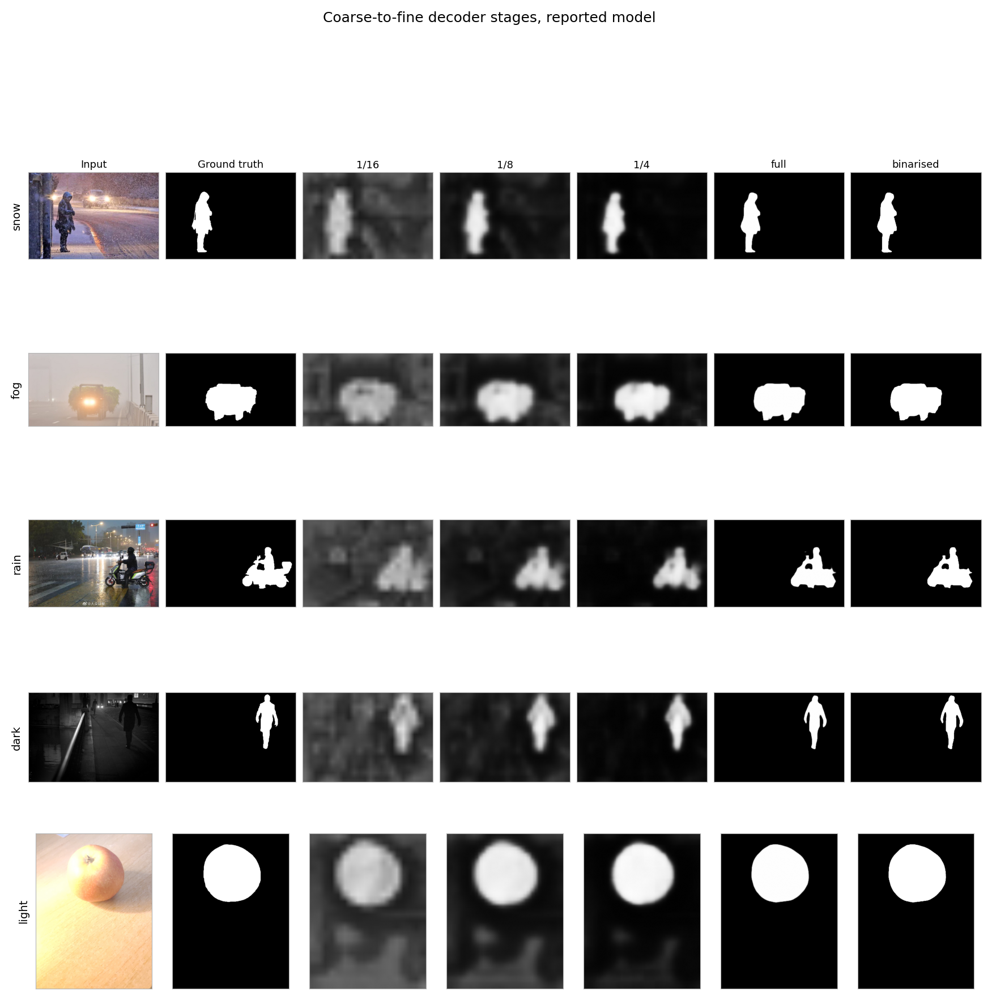
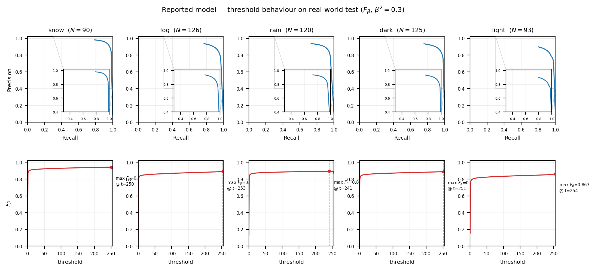
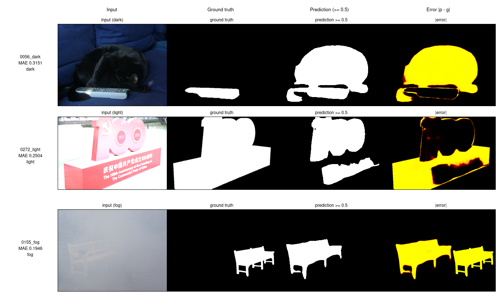

# SpatialMoE-SOD: Weather-Label-Free Salient Object Detection with Spatial Token-Level Expert Routing

<!--
FILL BEFORE SUBMISSION (the only placeholders in this document):
  1. [MENTOR NAME]                       — printed on the title page, the certificate and the acknowledgements.
  2. [DEPARTMENT / SCHOOL]                — default text "School of Engineering and Sciences" is from the template.
  3. [ROLL NUMBER]                        — student roll number (AP23110011266 is used here; correct it if wrong).
  4. Signature blocks in the Certificate.
Everything else is measured or implemented; every number in the report is traceable to a file in the
repository (see Appendix B), and every claim is bounded by Chapter 6.
-->

**UROP Project submitted to the**

**SRM University – AP, Andhra Pradesh**

for the partial fulfillment of the requirements to award the degree of

**Bachelor of Technology**

**in**

**Computer Science and Engineering**

**School of Engineering and Sciences**

---

### Submitted by

| Avinash Reddy Bapatu | Lalith Madhav Chundi | Anudeep Chowdary Muppalla | Sahadeb Shit |
|---|---|---|---|
| avinashreddy_bapatu@srmap.edu.in | lalithmadhav_chundi@srmap.edu.in | anudeep_muppalla@srmap.edu.in | sahadeb.s@srmap.edu.in |
| SRM University – AP | SRM University – AP | SRM University – AP | SRM University – AP |

Department of Computer Science and Engineering, School of Engineering and Sciences,
SRM University – AP, Neerukonda, Mangalagiri, Guntur, Andhra Pradesh 522 240, India.

*(Roll number AP23110011266 — see the certificate.)*

### Under the Guidance of

**Dr. [MENTOR NAME]**

**SRM University – AP**

**Neerukonda, Mangalagiri,**
**Guntur, Andhra Pradesh – 522 240**

**November 2026**

---

# Certificate

This is to certify that the UROP project report entitled **“SpatialMoE-SOD: Weather-Label-Free Salient Object Detection with Spatial Token-Level Expert Routing”**, submitted by **Avinash Reddy Bapatu (AP23110011266)** of the Department of Computer Science and Engineering, School of Engineering and Sciences, SRM University – AP, is a record of bonafide work carried out by the candidate under my supervision and guidance during the academic year 2026–27.

The work embodied in this report has not been submitted elsewhere for the award of any other degree or diploma.

 

| | |
|---|---|
| **Project Guide** | **Head of the Department** |
| Dr. [MENTOR NAME] | Dr. [HOD NAME] |
| Department of CSE | Department of CSE |
| SRM University – AP | SRM University – AP |

 

**External Examiner:** ____________________________  **Date:** ________________

---

# Acknowledgements

I would like to express my sincere gratitude to **Dr. [MENTOR NAME]** for the guidance, technical direction and steady encouragement provided throughout this project. The independence I was given to pursue the question honestly — including the freedom to report an ablation that did not support the original hypothesis — shaped both the work and the way it is presented here.

I thank the School of Engineering and Sciences at SRM University – AP for the computing resources and the academic environment that made the experiments possible, and the authors of the WXSOD benchmark for making their dataset, their reference tables and their baseline implementation publicly available, which is what allowed our numbers to be placed beside published ones at all.

I am grateful to my project collaborators — Lalith Madhav Chundi, Anudeep Chowdary Muppalla and Sahadeb Shit — for the discussions that produced the ablation design, for the patience with which they re-ran experiments whose outcome was uncertain, and for insisting that a negative result should be reported as carefully as a positive one.

Finally, I thank my family and friends for their constant support during the many late nights of training runs and log analysis.

---

# Table of Contents

| Section | Title |
|---|---|
| | Certificate |
| | Acknowledgements |
| | Abstract |
| | Abbreviations |
| | List of Figures |
| | List of Tables |
| **1** | **Introduction** |
| 1.1 | Background and Motivation |
| 1.2 | Problem Statement |
| 1.3 | Research Questions and Objectives |
| 1.4 | Contributions |
| 1.5 | Scope and Epistemic Status of the Claims |
| 1.6 | Organisation of the Report |
| **2** | **Literature Survey** |
| 2.1 | Salient Object Detection |
| 2.2 | Salient Object Detection Under Adverse Weather |
| 2.3 | Mixture-of-Experts for Adverse-Weather Restoration |
| 2.4 | Mixture-of-Experts in Dense Prediction |
| 2.5 | Token-Level Routing and Routing Entropy |
| 2.6 | Comparative Positioning |
| 2.7 | The Research Gap |
| **3** | **System Model** |
| 3.1 | Overview and Notation |
| 3.2 | Multi-Scale Feature Extraction |
| 3.3 | The Spatial Token-Level Router |
| 3.4 | Noisy Top-*K* Gating |
| 3.5 | Sparse Expert Dispatch and Aggregation |
| 3.6 | Routing Entropy and Entropy Fusion |
| 3.7 | The Cross-Attention Decoder |
| 3.8 | Training Objective |
| 3.9 | Parameter and Compute Budget |
| 3.10 | Inference-Time Interventions |
| 3.11 | Design Rationale |
| **4** | **Experimental Methodology** |
| 4.1 | Dataset |
| 4.2 | Splits and Validation Protocol |
| 4.3 | Preprocessing and Geometry |
| 4.4 | Augmentation and Targets |
| 4.5 | Training Configuration |
| 4.6 | Evaluation Metrics |
| 4.7 | Experimental Design and Arm Codes |
| 4.8 | Statistical Protocol |
| 4.9 | Reproducibility and Artifact Management |
| **5** | **Results and Discussion** |
| 5.1 | Headline Results |
| 5.2 | Comparison with Published Methods |
| 5.3 | Weather-Wise Analysis |
| 5.4 | Ablation Study |
| 5.5 | Inference-Time Interventions |
| 5.6 | Seed Variance and the Noise Floor |
| 5.7 | Routing Diagnostics: Entropy, Usage and Similarity |
| 5.8 | Qualitative Analysis and Failure Cases |
| 5.9 | What Drives the Result: Training Budget |
| 5.10 | What Is Measured and What Is Hypothesised |
| 5.11 | Discussion and Limitations |
| **6** | **Concluding Remarks** |
| **7** | **Future Work** |
| | References |
| A | Appendix A: Full Nineteen-Entry Benchmark Listing |
| B | Appendix B: Artifact and Reproducibility Map |

---

# Abstract

Salient object detection (SOD) degrades under adverse weather. This project asks whether a weather-label-free, single-RGB model can match weather-supervised SOD, and answers with an architecture built around spatial token-level mixture-of-experts (MoE) routing that uses no weather labels at training or at inference. A PVTv2-B4 backbone produces features at three pyramid scales; each scale has its own Spatial MoE layer, in which a depthwise-convolutional router turns every spatial token into eight logits, noisy top-*K*=2 selection sends the token to two of eight experts, and a genuinely sparse dispatch computes the weighted expert output. Per-token routing entropy — taken over the full eight-way gate distribution and normalised by log *E* — is projected and added to the routed features as an explicit decoder channel, and a cross-attention decoder fuses the three scales coarse-to-fine into saliency and boundary maps.

On the WXSOD benchmark the model reaches MAE 0.0192 on the 1,500 synthetic test images, the lowest of the 18 published entries (19 with ours), including the weather-supervised WFANet (0.0229), and the highest synthetic *S*φ (0.9140). On the 554 real-world test images its MAE of 0.0168 is a close second, within 0.0009 of WFANet (0.0159). An ablation study across eleven trained arms and three inference-time interventions shows that this performance is stable under removal or reduction of the mixture: the no-MoE, one-scale and no-load-balance variants are statistically equivalent to the reference by a two-one-sided-test (TOST) procedure at a ±0.001 MAE margin, although the arms are single-seed and differ in expert count. Routing entropy is near its ceiling — at least 99.2 % of log *E* in every functional arm but one — while the hard top-2 assignment is strongly skewed, with three experts absorbing about 84 % of assignments at the 1/8 scale and two experts effectively dead. The report ranks three candidate mechanisms for this behaviour, none of which has yet been tested by a direct measurement. The backbone and the decoder were not ablated; all results are for one backbone, one dataset and one training seed.

**Keywords:** salient object detection · mixture-of-experts · adverse weather · sparse routing · cross-attention decoder · equivalence testing

---

# Abbreviations

| Abbreviation | Expansion |
|---|---|
| AMP | Automatic Mixed Precision |
| BCE | Binary Cross-Entropy |
| BND / bMAE / bF1 | Boundary loss / boundary MAE / boundary F1 |
| CI | Confidence Interval |
| CSE | Computer Science and Engineering |
| DDP | Distributed Data Parallel |
| DS | Deep Supervision |
| DWConv | Depthwise Convolution |
| *E* | Number of experts per scale |
| *E*φ | Enhanced-alignment measure |
| *F*β | F-measure with β² = 0.3 |
| GN | Group Normalisation |
| GT | Ground Truth |
| *H*, *Ĥ* | Routing entropy (raw, normalised by log *E*) |
| IMP | Importance (auxiliary routing) loss |
| IoU | Intersection over Union |
| *K* | Top-*k* selection size |
| KL / JS | Kullback–Leibler / Jensen–Shannon divergence |
| LN | Layer Norm |
| LR | Learning Rate |
| MACs | Multiply–Accumulate Operations |
| MAE | Mean Absolute Error |
| MLP | Multi-Layer Perceptron |
| MoE | Mixture-of-Experts |
| PVT | Pyramid Vision Transformer |
| SOD | Salient Object Detection |
| *S*φ | Structure measure (S-measure) |
| TOST | Two One-Sided Tests (equivalence testing) |
| TTA | Test-Time Augmentation |
| UROP | Undergraduate Research Opportunities Programme |
| WXSOD | Weather eXtreme Salient Object Detection benchmark |

---

# List of Figures

| Figure | Caption | Source file |
|---|---|---|
| 1 | SpatialMoE-SOD architecture: backbone, three per-scale Spatial MoE layers, entropy fusion, cross-attention decoder, heads | `paper/figures/fig_architecture.pdf` |
| 2 | Routing for one token at one pyramid scale: DWConv context, MLP logits, noisy top-*K*, sparse experts | `paper/figures/fig_routing.pdf` |
| 3 | Nineteen-entry ranking on the synthetic and real test splits | `paper/figures/fig_benchmark_panels.tex` |
| 4 | Paired MAE difference per arm against the reference, with the ±0.001 equivalence band | `paper/figures/fig_forest_equivalence.pdf` |
| 5 | Real-test MAE against normalised routing entropy for every trained arm | `paper/figures/fig_arms_mae_entropy.pdf` |
| 6 | The same scenes predicted by eight different trained arms | `paper/figures/fig_arms_grid.png` |
| 7 | Matched pair: full MoE (Ref) against the no-MoE arm (A6), both 8 epochs | `paper/figures/fig_moe_vs_none_matched.png` |
| 8 | Per-condition MAE on both test splits | `paper/figures/fig_weather_bars.tex` |
| 9 | The three highest-error real-test images: input, ground truth, prediction, absolute error | `paper/figures/fig_failures.png` |
| 10 | Precision–recall and *F*β versus threshold, per real-world condition | `paper/figures/fig_pr_curves.png` |
| 11 | Progressive refinement through the decoder stages | `paper/figures/fig_stages.png` |
| 12 | Hard-assignment expert usage per pyramid scale | `paper/figures/fig_expert_usage.pdf` |

# List of Tables

| Table | Caption |
|---|---|
| 2.1 | Comparative positioning against prior mixture-of-experts and adverse-weather methods |
| 3.1 | Choice of the routing granularity and why finer alternatives were rejected |
| 3.2 | Parameter and compute budget of the reported model at 384 × 384 |
| 4.1 | WXSOD splits and their composition |
| 4.2 | Training configuration of the reported model and of the ablation family |
| 4.3 | Ablation arm codes |
| 5.1 | Headline metrics of the reported model on both test splits |
| 5.2 | Comparison with published WXSOD results |
| 5.3 | Weather-wise results on both test splits |
| 5.4 | All trained arms: MAE and *S*φ on both splits |
| 5.5 | Paired bootstrap and TOST results against the reference |
| 5.6 | Inference-time interventions on the reference checkpoint |
| 5.7 | Seed variance for the reference configuration |
| 5.8 | Routing entropy per scale, dead experts and expert similarity |
| 5.9 | Routing entropy per scale for every trained arm |
| 5.10 | Firm measurements versus candidate mechanisms |
| A.1 | All nineteen benchmark entries, both splits, both metrics |

---

# 1. Introduction

## 1.1 Background and Motivation

Salient object detection (SOD) is the task of segmenting, at pixel level, the region of an image that a human observer would find most visually prominent [1], [2]. In the last decade it has moved from hand-crafted contrast priors to fully convolutional and transformer-based models whose accuracy on clean benchmarks is high enough that the interesting failures now occur on *degraded* input. Adverse weather — fog, rain, snow and the low-light conditions that accompany them — is one such degradation, and it is a hard one: it changes the statistics of the input globally, it is spatially heterogeneous, and, crucially, the correct output is *not* a restored image but a segmentation that must remain correct after the degradation has been partially removed.

The practical importance is straightforward. Any system that must localise a person, a vehicle or an obstacle outdoors — driver assistance, surveillance, search and rescue, autonomous navigation — has to operate in weather that the training distribution of a conventional SOD model does not represent.

Two strategies dominate the literature. The first conditions the model on the weather: the model is told, either by metadata at inference or by an explicitly trained classifier, which condition it is looking at, and the network adapts its features accordingly. The WXSOD benchmark's own baseline, WFANet, trains a nine-class weather classifier and conditions feature fusion on its output [3]; NIFM fuses noise indicators derived from explicit weather-type one-hot vectors [4]. Both are effective, and both inherit a dependency: they need weather supervision during training, and the class-conditioned variant needs the weather label at inference as well. The second strategy applies mixture-of-experts to weather *restoration* — WM-MoE routes tokens through experts chosen by weather-aware gating [5] — but restoration is a dense regression task in which the objective is a small per-pixel residual, not a segmentation decision.

The motivation for this project is the gap between those two strategies. Weather-dependent models work but are constrained by the supervision they require; weather-restoration models route adaptively but solve a different problem. The question we set out to answer is whether a model can obtain the robustness of the first without the supervision of either.

## 1.2 Problem Statement

We consider single-RGB salient object detection under adverse weather with **no weather label available at training time and none at inference**. The system receives one image and must return a saliency mask. It may not receive a weather class, a weather embedding, a one-hot condition vector, or any auxiliary modality; it may not be trained with a weather-classification objective.

Within that constraint, the design question is where the adaptive capacity should live. Our answer is: in the *routing* rather than in the conditioning. Instead of telling the network which weather it is in, we let each spatial token decide, from its own content and its local neighbourhood, which of several expert subnetworks should process it. Because tokens from foggy regions, snowy regions and clear regions of the same image can be routed differently, the mechanism is finer-grained than an image-level weather label — and it requires no label at all.

## 1.3 Research Questions and Objectives

**RQ1 — Accuracy.** Can a single-RGB, weather-label-free model match the accuracy of weather-supervised SOD on a standard adverse-weather benchmark?

**RQ2 — Attribution.** If it can, what is responsible? Specifically, does the mixture-of-experts machinery — the routing, the experts, the routing-entropy channel — contribute measurably to the accuracy, or is the result driven by the backbone, the decoder and the training budget?

**RQ3 — Mechanism.** If the routing contributes little in accuracy terms, why? What does the router actually do, and which measurement would discriminate between the candidate explanations?

The objectives of the project follow directly:

1. Design and implement a single-RGB SOD architecture with spatial token-level MoE routing at multiple pyramid scales and no weather-specific component.
2. Train it under a fixed, documented recipe and evaluate it on WXSOD's synthetic and real test splits.
3. Place the resulting numbers beside the benchmark's published entries, under a stated protocol and with the protocol difference disclosed.
4. Ablate the design — the mixture itself, its routing scope, its gate, its auxiliary losses, the expert count and the top-*k* — and test each variant for statistical equivalence against the reference.
5. Intervene on the trained model at inference time to separate "the component is removable" from "the component was never trained to matter".
6. Diagnose the observed routing behaviour and state the candidate mechanisms together with the measurement that would settle them.

## 1.4 Contributions

1. **An architecture** for weather-label-free single-RGB SOD: a token-level spatial router that assigns each token to top-*K* = 2 experts out of 8 per scale, using depthwise-convolutional context, noisy top-*K* gating and true sparse dispatch; three independent routers at pyramid scales 1/4, 1/8 and 1/16 with a separate expert pool each; and routing entropy over the full expert distribution, normalised by log *E*, injected as an explicit decoder feature through learnable additive fusion. Along with it, the weather-label-free results: MAE 0.0192 on the synthetic split (lowest of the 18 published entries, 19 with ours) and 0.0168 on the real split (second of nineteen, ours included).
2. **A comparison** with the published methods of the WXSOD benchmark on both test splits, reported as published: first on the synthetic split on both MAE and *S*φ, and second on the real split on MAE, behind the weather-supervised WFANet.
3. **An ablation and intervention study** — eleven trained arms and three inference-time interventions — showing that the result is stable under removal or reduction of the mixture, with the no-MoE, one-scale and no-load-balance variants certified equivalent to the reference by a TOST procedure at a ±0.001 MAE margin.
4. **A candidate explanation** of why the mixture contributes so little measurably, presented as a ranked set of hypotheses rather than as a settled mechanism, each with the evidence bearing on it and the measurement that would discriminate it.

## 1.5 Scope and Epistemic Status of the Claims

This report deliberately separates three kinds of statement, and the separation is maintained throughout:

* **Measured.** Directly computed from a trained model's outputs on a named test split, with a result file that a reader can open. Example: real-test MAE of 0.0168 for the reported checkpoint.
* **Inferred / hypothesised.** A candidate explanation consistent with the measurements but not established by them. Example: experts are near-identical at initialisation, leaving the gate nothing to separate.
* **Out of scope.** Statements the evidence cannot support at all: that the mixture improves accuracy, that experts specialise by weather, that any particular design choice *causes* the result, or that the model is state of the art.

The consequence is a report in which the central empirical result is a **null result about the mixture**, reported alongside a **positive result about the pipeline**: the pipeline attains competitive accuracy without any weather label, and removing the mixture does not change that accuracy.

## 1.6 Organisation of the Report

Chapter 2 surveys salient object detection, adverse-weather SOD, mixture-of-experts in restoration and in dense prediction, and token-level routing, and ends with an explicit statement of the gap this project addresses. Chapter 3 specifies the system model: backbone, router, gating, dispatch, entropy fusion, decoder and objective, with the parameter and compute budget. Chapter 4 documents the experimental methodology — dataset, splits, preprocessing, training configuration, metrics, arm design, statistical protocol and artifact management — at the level of detail needed to reproduce it. Chapter 5 reports and discusses the results, including the ablations, the inference-time interventions, the seed-variance floor and the routing diagnostics. Chapter 6 states the concluding remarks in the restricted form the evidence supports, and Chapter 7 lists the experiments that would be needed to go beyond it.

---

# 2. Literature Survey

## 2.1 Salient Object Detection

SOD has been surveyed comprehensively in the deep-learning era [1], and the benchmark literature that established the evaluation conventions is equally mature [2]. The metric family used in this report — MAE, the structure measure *S*φ [6], the enhanced-alignment measure *E*φ [7], the maximum F-measure [8] — is the standard one, and its provenance matters for the comparisons in Chapter 5: published numbers are only comparable if they were produced under the same metric definitions and the same input convention.

Architecturally, contemporary SOD is dominated by two families. Convolutional encoder–decoders with multi-scale aggregation remain strong and cheap; transformer backbones with pyramid structure provide global receptive fields at manageable cost, and PVTv2 [9], used here, belongs to that family. A recurring finding across the literature is that the *backbone* does most of the representational work and that the segmentation head largely refines boundaries — an observation our own decoder-stage analysis reproduces (Section 5.8).

## 2.2 Salient Object Detection Under Adverse Weather

Robustness to corruption is an established evaluation axis in vision [10], and adverse-condition datasets exist for driving-scene understanding [11]. For SOD specifically, WXSOD [3] is the benchmark used in this report. It provides 12,891 synthetic training images, 1,500 synthetic test images across nine conditions (including three compound conditions: rain+fog, rain+snow, snow+fog) and 554 real-world test images across five conditions (fog, rain, snow, dark, light), together with published results for seventeen SOD methods and its own weather-supervised baseline, WFANet.

WFANet trains a weather classifier over nine categories and conditions feature fusion on its output. NIFM [4] takes a different route to the same dependency, fusing noise indicators derived from explicit weather-type one-hot vectors. Both therefore require weather supervision at training time, and the class-conditioned variant requires it at inference too. **This is the property that makes our comparison meaningful**: the numbers in Table 5.2 differ not only in accuracy but in what supervision each method was given.

## 2.3 Mixture-of-Experts for Adverse-Weather Restoration

Mixture-of-experts has been applied extensively to adverse-weather *restoration* — TransWeather [12] and All-in-One [13] are representative, and WM-MoE [5] is the closest in spirit to our mechanism: it routes at token level, with weather-aware gating, to a set of experts specialised for different degradations.

Three differences define our position. First, **task**: restoration is per-pixel reconstruction, where the objective is a small residual error and where a spatially varying expert assignment is directly useful; SOD is a classification-like segmentation in which the decision is largely made by the backbone's features, and our measurements suggest that in that setting the mixture has little room to act (Chapter 5). Second, **supervision**: WM-MoE's gate is driven by weather features learned through a weather branch; ours is driven by the token's own content and its depthwise-convolutional neighbourhood, with no weather-specific component anywhere. Third, **granularity of the decision**: WM-MoE uses one router; we use three independent routers, one per pyramid scale, with separate expert pools, so the finest scale can route on local texture while the coarsest routes on scene structure.

## 2.4 Mixture-of-Experts in Dense Prediction

Within dense prediction, MoE-SPNet applies a scene-level mixture to semantic segmentation [14]. SegMoTE applies token-level routing to medical image segmentation [15], with the router conditioned on modality. Pavlitska et al. study the *behaviour* of sparse MoE layers inside CNN semantic segmentation [16], and an earlier study of the same group uses MoE to obtain insight into segmentation representations [17]. Spatial MoE (SMoE) was introduced for dense regression on spatially structured scientific data such as weather and climate fields [18], where the spatial structure of the input is the natural routing signal.

The pattern is consistent: existing dense-prediction routers are conditioned on something external — scene, modality, task, or scientific field — or are applied to regression targets. None addresses adverse-weather SOD from a single RGB input with per-token, label-free routing at multiple scales.

## 2.5 Token-Level Routing and Routing Entropy

Sparse mixtures of experts go back to adaptive mixtures of local experts [19]. Token-level top-*K* routing in vision was established by V-MoE [20] for classification, building on the sparsely-gated MoE layer of Shazeer et al. [21] whose noisy top-*k* gating we adopt, and on the GShard, Switch and ST-MoE line [22], [23], [24] that made very large sparse models trainable; Mixtral [25] scaled the same recipe further in language modelling. In multi-task and multi-modal settings, routers are typically task- or modality-conditioned [26], [27]; M4-SAM applies a multi-modal mixture with memory augmentation to RGB-D video SOD [28].

Routing entropy is usually treated as a diagnostic — a measure of how decisive the gate is — or as an uncertainty signal. Our use is different: we *feed* the normalised per-token routing entropy into the decoder as an explicit spatial feature channel. To our knowledge no prior work in dense prediction does this, and it is the element of the design with the strongest claim to novelty. It is also, as Chapter 5 shows, the element whose contribution turns out to be unmeasurable at this recipe: because the entropy is nearly constant, the channel it produces is nearly constant.

## 2.6 Comparative Positioning

**Table 2.1 — Comparative positioning against prior mixture-of-experts and adverse-weather methods**

| Work | Task | Routing granularity | Routing signal | Weather labels | Per-scale routers | Entropy into decoder |
|---|---|---|---|---|---|---|
| WM-MoE [5] | Restoration | Token-level | Content + weather features | No labels at test time, but a weather branch exists | No (one router) | No |
| NIFM [4] | Adverse-weather SOD | None (one-hot conditioning) | Explicit weather type | **Yes** | No | No |
| WFANet [3] | Adverse-weather SOD | Image-level branch | Predicted weather class | **Yes** | No | No |
| MoE-SPNet [14] | Scene parsing | Scene-level | Learned | n/a | No | No |
| SegMoTE [15] | Medical segmentation | Token-level | Modality | n/a | No | No |
| SMoE [18] | Scientific dense regression | Spatial | Spatial structure | n/a | No | No |
| V-MoE [20] | Classification | Token-level top-*k* | Learned | n/a | No | No |
| M3ViT [26] | Multi-task | Token-level, task-conditioned | Task embedding | n/a | No | No |
| **This work** | **Adverse-weather SOD** | **Token-level, per scale** | **Spatial content only** | **None** | **Yes, three independent** | **Yes** |

## 2.7 The Research Gap

The defensible statement of novelty is a *combination*, not any single element:

* token-level spatial routing applied to SOD (element A),
* three independent routers with separate expert pools (element C),
* routing entropy as an explicit decoder feature (element D),
* applied to adverse-weather SOD without any weather-specific component (element E).

Individual elements have partial precedents, and the survey above records them. Element D — entropy as a decoder channel — has, to our knowledge, no direct precedent in dense prediction. A claim of this kind is a claim about the literature we could search, not a theorem, and we state it as such.

The **gap** the project addresses is therefore: no published method we could find combines spatial token-level routing with SOD under adverse weather, without a weather-specific component or weather supervision. That is the gap RQ1 is asked about, and Chapter 5 answers it — including the part of the answer the original hypothesis did not anticipate.

---

# 3. System Model

## 3.1 Overview and Notation

**Figure 1** — [Architecture overview](paper/figures/fig_architecture.pdf). A PVTv2-B4 backbone produces features at three resolutions. Each scale has its own Spatial MoE layer: a depthwise-convolutional router turns every token into eight logits, noisy top-*K* = 2 sends the token to two of eight experts, and the experts' outputs are combined with their gate weights. Per-token routing entropy, taken over the full eight-way distribution and normalised by log *E*, is projected and added to the routed features. The cross-attention decoder merges the three scales coarse-to-fine, and two 1×1 convolutions produce the saliency and boundary maps.

Let an input image be **X** ∈ ℝ3×H×W. The model produces a saliency map **M̂**sal ∈ [0,1]H×W and a boundary map **M̂**bnd ∈ [0,1]H×W. Working resolution is 384×384, working width is *C* = 256, the number of experts per scale is *E* = 8, and the selection size is *K* = 2. Scales are indexed by *s* ∈ {4, 8, 16} denoting the stride.

| Symbol | Meaning |
|---|---|
| *s* | pyramid scale (stride 4, 8 or 16) |
| *N*s | number of tokens at scale *s* (= *H*s*W*s) |
| **x**i ∈ ℝ*C* | the *i*-th token at one scale |
| *E*, *K* | experts per scale, selected experts per token |
| *h*i ∈ ℝ*E* | router logits for token *i* |
| 𝒯i | set of selected experts (|𝒯i| = *K*) |
| *g*i,k | gate weight for expert *k* on token *i* |
| ℰk | the *k*-th expert (a token-wise MLP) |
| *H*i, *Ĥ*i | routing entropy, and its normalisation by log *E* |
| λs | learnable scale on the entropy channel |

## 3.2 Multi-Scale Feature Extraction

A PVTv2-B4 backbone [9], pretrained on ImageNet, extracts features at three scales using `out_indices = (0, 1, 2)`. Each scale is projected to the common width *C* = 256 by a 1×1 convolution, denoted Projs:

$$\mathbf{X}_s = \mathrm{Proj}_s\bigl(\mathrm{Backbone}(\mathbf{X})_s\bigr) \in \mathbb{R}^{C \times H_s \times W_s}$$

with (*H*s, *W*s) ∈ {(96,96), (48,48), (24,24)}. Each feature map is reshaped into *N*s tokens of dimension *C*: 9,216 tokens at 1/4, 2,304 at 1/8 and 576 at 1/16.

Why this backbone: PVTv2 offers a hierarchical pyramid with a global receptive field at the coarsest level, which is what makes coarse-to-fine cross-attention meaningful; and its four-stage structure gives three usable levels at a cost of 51.18 M parameters, roughly three quarters of the total budget. **It is not ablated**, and Section 5.11 explains the consequence: attributing the result to "the backbone" would in fact attribute it to the backbone, decoder and loss together.

## 3.3 The Spatial Token-Level Router

**Figure 2** — [Routing mechanism for one token](paper/figures/fig_routing.pdf). A depthwise 3×3 convolution supplies local context, which is concatenated with the token and passed through a two-layer MLP to give eight routing logits. Input-dependent Gaussian noise is added during training; top-*K* = 2 then selects two experts, and the gate weights are a softmax over those two logits only. Each selected expert is a residual MLP with a 4× channel expansion. Routing entropy is taken over the *full* eight-way distribution, not the selected pair.

For each scale, a depthwise 3×3 convolution captures local spatial context from the feature map. The router input concatenates each token with its local context:

$$\mathbf{r}_i = \bigl[\mathbf{x}_i \;\big|\; \mathrm{DWConv}_{3\times3}(\mathbf{X}_s)_i\bigr] \in \mathbb{R}^{2C}$$

where | denotes channel-wise concatenation. The result is a 512-dimensional vector encoding both the token's content and its spatial neighbourhood — the design decision that makes this a *spatial* router rather than a content-only one.

A two-layer MLP produces the routing logits:

$$\mathbf{h}_i = W_2 \cdot \mathrm{GELU}(W_1 \mathbf{r}_i + b_1) + b_2 \in \mathbb{R}^{E}$$

with *W*1 ∈ ℝ128×512 and *W*2 ∈ ℝ8×128. The hidden width of 128 is a deliberate bottleneck between the 512-dimensional input and the 8-dimensional output: it keeps the router's parameter count negligible beside the experts (the three MoE layers together are 12.84 M parameters, of which the routers are a small fraction) and prevents the router from becoming a second classifier.

**Table 3.1 — Routing granularity: alternatives considered and rejected**

| Granularity | Why it was not used |
|---|---|
| Image-level (one gate per image) | Cannot separate foggy and clear regions of the same image; degenerates to weather classification, which is what the project avoids |
| Scene-level [14] | Same objection at a coarser scale |
| Modality-level [15], [26] | Requires a second modality or a task embedding; single-RGB input has neither |
| Token-level, content only | Ignores the spatial structure of weather, which is locally homogeneous (a fog bank has a boundary) |
| **Token-level with local context (chosen)** | Separates adjacent regions with different local statistics without any external signal |

## 3.4 Noisy Top-*K* Gating

During training, Gaussian noise is added with an input-dependent scale to encourage exploration:

$$\tilde{h}_{i,j} = h_{i,j} + \epsilon_{i,j}, \qquad \epsilon_{i,j} \sim \mathcal{N}\bigl(0, \sigma_j^2(\mathbf{x}_i)\bigr), \qquad \sigma_j(\mathbf{x}_i) = \max\bigl(\mathrm{softplus}(w_j^\top \mathbf{x}_i + b_j),\, 0.05\bigr)$$

At inference the noise is disabled (*ε* = 0). The top-*K* = 2 experts are selected per token, and the gate weights are a softmax over the *selected* logits only:

$$g_{i,k} = \frac{\exp(\tilde{h}_{i,k})}{\sum_{j \in \mathcal{T}_i} \exp(\tilde{h}_{i,j})}, \qquad k \in \mathcal{T}_i = \operatorname{top\text{-}k}_{j}\bigl(\tilde{h}_{i,j}, K{=}2\bigr)$$

Two consequences of this form matter later. First, the gate is a softmax over two values, so at near-equal logits the weights sit near 0.5 and the two-way Jacobian *g*(1−*g*) is at its maximum (~0.25) — the gate is *not* gradient-starved in the naïve sense. Second, the noise scale has a floor of 0.05; at initialisation the learned scale is of order 0.7 against logits of order 0.1, so training-time selection begins close to random. Both observations feed the hypotheses of Section 5.10.

## 3.5 Sparse Expert Dispatch and Aggregation

Each expert ℰk executes only on the tokens that selected it. Writing 𝒜k = {*i* : *k* ∈ 𝒯i} for its assigned set, the layer computes

$$\mathbf{y}_i = \sum_{k \in \mathcal{T}_i} g_{i,k} \cdot \mathcal{E}_k(\mathbf{x}_i)$$

implemented as a loop over experts with mask-based selection and scatter-add — *true* sparsity, not dense computation with masking. Each expert is a token-wise residual MLP:

$$\mathcal{E}_k(\mathbf{x}) = \mathbf{x} + W_k^{(2)} \cdot \mathrm{GELU}\bigl(W_k^{(1)} \cdot \mathrm{LN}(\mathbf{x})\bigr)$$

with *W*k(1) ∈ ℝ1024×256 and *W*k(2) ∈ ℝ256×1024 (a 4× expansion). Reshaping the per-token outputs gives **Y**s ∈ ℝ*C*×*H*s×*W*s.

Three implementation details are load-bearing and are stated here because they are easy to get wrong:

1. **Every expert is invoked on every forward pass**, even when it receives no tokens (an empty slice). This is required for distributed gradient synchronisation: with different ranks routing to different experts, conditional invocation would desynchronise the all-reduce. The cost is negligible; the alternative is a silent hang.
2. **There are 24 experts in total**, eight per scale, with no weight sharing across scales.
3. **The layer is exactly a weighted selection operator.** With **Π** ∈ {0,1}*N*×*E* the top-*K* selection matrix and **g** the gate matrix, the layer is **Y** = (**Π** ⊙ **g**) · ℰ(**X**). Everything the routing can do to the output is mediated by this weighting, and what it weights is a *difference* between experts — which is where the diagnosis in Section 5.10 begins.

## 3.6 Routing Entropy and Entropy Fusion

Per-token routing entropy measures assignment uncertainty over the **full** expert distribution, not only the selected pair:

$$\mathcal{H}_i = -\sum_{j=1}^{E} p_{i,j} \log p_{i,j}, \qquad \hat{\mathcal{H}}_i = \mathcal{H}_i / \log E \in [0,1]$$

where *p*i,j is the router's softmax probability for expert *j* over all *E* experts. The normalising constant is log *E*, matching the eight-expert model, so that 0 means a single expert dominates and 1 means a uniform assignment over all eight.

The normalised entropy map *Ĥ*s ∈ ℝ1×*H*s×*W*s is fused with the MoE output through a learnable additive block:

$$\mathbf{F}_s = \mathbf{Y}_s + \lambda_s \cdot \mathrm{Proj}_{\mathcal{H}}\bigl(\hat{\mathcal{H}}_s\bigr)$$

where Projℋ is a 1×1 convolution from 1 to *C* channels and λs is a learnable scalar initialised to 0.1. *Ĥ*s is computed from the router logits and is **not detached**, so the decoder is a second, direct, differentiable path from the task gradient to the router. That path is weak when the gate is near-uniform — ∂*Ĥ*/∂*h* → 0 there — but it is not zero, a point that matters when interpreting the *k* = 1 arm.

Because the entropy is a *spatial* map, the channel gives the decoder per-token information about routing uncertainty at each location: a foggy boundary between an assigned and an unassigned region is, in principle, a place where the decoder should trust the routed features less. Making that information explicit rather than implicit in the features is the design hypothesis behind the fusion.

## 3.7 The Cross-Attention Decoder

The decoder merges coarse-to-fine features through top-down cross-attention [29]. At the coarsest level, **F**16 is upsampled and used as queries with **F**8 as keys and values (8-head global attention):

$$\mathbf{F}_8' = \mathrm{GlobalCrossAttn}\bigl(Q = \mathrm{Up}(\mathbf{F}_{16}),\; KV = \mathbf{F}_8\bigr)$$

Global context is then injected into the fine scale:

$$\mathbf{F}_4^{\text{ctx}} = \mathbf{F}_4 + \mathrm{Proj}_g\bigl(\mathrm{AvgPool}(\mathbf{F}_8')\bigr)$$

where Projg is a 1×1 convolution over the *C* = 256 channels, applied after global average pooling. **F**8′ is upsampled and used as queries against **F**4ctx with 7×7 windowed attention [30]:

$$\mathbf{F}_4' = \mathrm{WinCrossAttn}\bigl(Q = \mathrm{Up}(\mathbf{F}_8'),\; KV = \mathbf{F}_4^{\text{ctx}}\bigr)$$

Windowed attention is used here for the same reason it is used in Swin: at 1/4 resolution the token count is 9,216, and dense attention over that set is both expensive and unnecessary given that the coarse level already carries global context. The window partition carries a relative-position bias table and a padding mask, so non-divisible spatial sizes still round-trip exactly.

Three refinement blocks then upsample from 1/4 to full resolution, each consisting of Conv 3×3 → GroupNorm(32) [31] → ReLU → Conv 3×3 → GroupNorm → ReLU → residual addition, with bilinear ×2 upsampling between blocks. Two 1×1 convolution heads produce saliency logits and boundary logits at 384×384, and — when deep supervision is enabled — three auxiliary saliency heads at 1/16, 1/8 and 1/4.

## 3.8 Training Objective

The objective is a weighted sum of the eight terms active in the reported configuration; the Z-loss and the router-confidence term are disabled:

$$\mathcal{L} = \lambda_{\mathrm{BCE}}\mathcal{L}_{\mathrm{BCE}} + \lambda_{\mathrm{IoU}}\mathcal{L}_{\mathrm{IoU}} + \lambda_{\mathrm{SSIM}}\mathcal{L}_{\mathrm{SSIM}} + \lambda_{\mathrm{BND}}\mathcal{L}_{\mathrm{BND}} + \lambda_{\mathrm{LB}}\mathcal{L}_{\mathrm{LB}} + \lambda_{\mathrm{IMP}}\mathcal{L}_{\mathrm{IMP}} + \lambda_{\mathrm{auxBND}}\mathcal{L}_{\mathrm{auxBND}} + \lambda_{\mathrm{DS}}\mathcal{L}_{\mathrm{DS}}$$

with λBCE = λIoU = λSSIM = λBND = 1.0, λLB = λIMP = 0.01, λauxBND = 0.5 and λDS = 0.4. ℒLB is the mean over the three scales.

| Term | Form | Purpose |
|---|---|---|
| ℒBCE | Binary cross-entropy between saliency logits and mask | Pixel classification |
| ℒIoU | Soft IoU: 1 − Σ(*σ*(M̂)·M + ε)/Σ(*σ*(M̂) + M − *σ*(M̂)·M + ε) | Region overlap, scale-free |
| ℒSSIM | 1 − structural similarity [32] | Structural agreement of the map |
| ℒBND | Smooth-*L*1 between predicted gradient magnitude and the ground-truth boundary map [33] | Edge fidelity |
| ℒLB | *E* Σj *f*j *P*j, averaged over scales [21] | Load balancing across experts |
| ℒIMP | (std(**P**)/mean(**P**))² | Expert-usage spread |
| ℒauxBND | BCE between boundary-head logits and boundary map | Supervises the head directly |
| ℒDS | Mean BCE of the three auxiliary saliency heads [34] | Deep supervision |

The three auxiliary heads are the only parameters deep supervision adds, and they account exactly for the difference between the 69,212,349-parameter model without them and the reported 69,213,120-parameter model with them.

**The reported recipe and the ablation recipe are not identical**, and the difference matters for everything in Chapter 5. The ablation family — the eleven arms trained under the current code — uses per-scale load-balance weights 0.08/0.15/0.10 (applied separately, one per scale, rather than a single weight on the mean), λIMP = 0.05, and a Z-loss with λZ = 0.001. The Z-loss, ℒZ = (log Σj ehj)², is minimised by *small* router logits and therefore pushes the gate towards uniform — which makes it a direct candidate cause of the flat routing entropy examined in Section 5.10.

## 3.9 Parameter and Compute Budget

**Table 3.2 — Parameter and compute budget of the reported model at 384 × 384**

| Component | Parameters (M) | Share |
|---|---|---|
| PVTv2-B4 backbone | 51.18 | 73.9 % |
| Cross-attention decoder | 5.19 | 7.5 % |
| Spatial MoE (3 scales × 4.28 M) | 12.84 | 18.6 % |
| **Total** | **69.21** | 100 % |
| MACs per image | 277.9 G | — |

Two honest notes on this table. First, the model is **larger** than the weather-supervised baseline WFANet (50.87 M), so the accuracy comparison in Table 5.2 is not accompanied by an efficiency advantage; we state the parameter counts rather than making an efficiency claim. Second, the MoE layers account for 18.6 % of the parameters but, as Chapter 5 establishes, none of the measurable accuracy — which is precisely what makes the ablation interesting rather than merely negative.

## 3.10 Inference-Time Interventions

The forward pass exposes an optional intervention hook with three operations, used in Section 5.5:

| Operation | Effect |
|---|---|
| `expert_id` (+ `scale`) | Force *every* token at one scale to a single expert, bypassing selection |
| `random_routing` | Replace learned gates with random logits, keeping top-*K* structure |
| `disable_entropy` | Drop the entropy channel from the fusion |

These perturb a *trained* model; they do not retrain it. That distinction is the point of Section 5.5 and of a stated limitation: an intervention can show that a component is removable at inference, but not that it would have been useless if trained differently.

## 3.11 Design Rationale

Three design decisions deserve an explicit justification, because each was a hypothesis before it was a result.

**Why route at all, rather than condition?** Conditioning needs a label or a classifier; routing needs neither, and it operates at a finer granularity than any image-level label. If weather structure is spatially local — a fog bank, a wet road surface, a snow-covered region — then per-token routing is the architecture that can express it and a weather classifier is not.

**Why three independent routers rather than one shared router?** A shared router must compromise between the statistics of 1/4-scale tokens, which are local and texture-like, and those of 1/16-scale tokens, which are global and scene-like. Independent routers with separate expert pools let each scale make its own decision at its own granularity. The ablation arm A8 (routing at 1/4 only) tests the opposite hypothesis, that the other two scales are doing nothing.

**Why feed entropy into the decoder?** Because the routed features and the routing decision are different quantities, and the decoder can only see the former. Making the decision visible as a channel lets the decoder modulate its trust spatially — the hypothesis being that where routing is uncertain, the fused features should be down-weighted. Chapter 5 shows the mechanism is inert at this recipe for an identifiable reason: the entropy channel is nearly constant, because the gate distribution is nearly uniform. The design hypothesis is not refuted, but at this recipe it is not testable either.

---

# 4. Experimental Methodology

## 4.1 Dataset

All experiments use the WXSOD benchmark [3] (repository: `https://github.com/C-water/WXSOD`). No new data were collected, and no synthetic data were generated.

**Table 4.1 — WXSOD splits and their composition**

| Split | Images | Role | Conditions |
|---|---|---|---|
| `train_sys` | 12,891 | Training (with a derived validation split) | Synthetic: clean, dark, fog, light, rain, rain+fog, rain+snow, snow, snow+fog |
| `test_sys` | 1,500 | Held-out synthetic test | The same nine conditions |
| `test_real` | 554 | Held-out real-world test | Five conditions: dark, fog, light, rain, snow |

Weather labels are carried in the filename (`{scene_id}_{weather}.ext`) and are parsed by the loader. **They are used only for reporting per-condition metrics; they never enter the model, the loss or the routing.** This is the property that distinguishes the comparison in Section 5.2 from the published baselines.

## 4.2 Splits and Validation Protocol

The validation set is carved out of `train_sys` with a **scene-aware `GroupShuffleSplit`** at 20 %, so that no scene appears in both halves, and the splitter carries an explicit disjointness assertion — if a scene id were to leak across the boundary, the run fails rather than silently over-fitting. The split is derived at load time rather than shipped as a separate directory, so it cannot drift out of sync with the training data.

Verified composition:

| Split | clean | dark | fog | light | rain | rain+fog | rain+snow | snow | snow+fog |
|---|---|---|---|---|---|---|---|---|---|
| train | 508 | 1,230 | 1,228 | 1,217 | 1,210 | 1,265 | 1,197 | 1,232 | 1,255 |
| validation | 123 | 305 | 306 | 314 | 314 | 297 | 297 | 315 | 278 |

Model selection uses validation MAE only. **No test split enters model selection**, which is why the headline numbers can be reported without a selection-bias caveat.

## 4.3 Preprocessing and Geometry

Each image is resized so that its longest side reaches 384 and is then **centre-padded** to 384×384: reflect padding (`BORDER_REFLECT_101`) for the image, constant zero for the mask and the edge map, with a validity mask recording the padded region. The original size and every pad amount are stored in the sample's metadata, which is what lets evaluation undo the transform exactly (`reverse_geometry`) before scoring.

Two consequences are worth stating explicitly:

* **Every metric in this report is computed in original image coordinates**, never in the padded model frame. This removes a class of silent error in which padded borders inflate or deflate MAE.
* Because the padding is centred and reflective, flipping a padded image at test time is geometrically equivalent to mirroring the original — so flip-average test-time augmentation is well posed here rather than approximate.

## 4.4 Augmentation and Targets

| Split | Pipeline |
|---|---|
| train | `HorizontalFlip(p = 0.5)`, `ColorJitter(p = 0.5)`, ImageNet normalisation |
| val / test | normalisation only |

Augmentation is applied *after* the geometry step and is deterministically seeded per sample and per epoch (an MD5 of the base seed, the epoch, the index and the file name), so a run is reproducible while still varying across epochs. Because the model is trained with horizontal flips, the flipped forward pass inside TTA is in-distribution rather than a probe of the network.

Boundary targets are produced by morphological *dilate-minus-erode* with a 5×5 elliptical kernel. This gives a thin band that the boundary loss and the boundary head can be trained against without hand annotation.

## 4.5 Training Configuration

**Table 4.2 — Training configuration of the reported model and of the ablation family**

| Element | Reported model **R** | Ablation family (**Ref**, A1–A10) |
|---|---|---|
| Hardware / parallelism | 2 GPUs, DDP, AMP fp16 with a GradScaler | Same |
| Optimiser | AdamW [35], lr 1×10⁻⁴ (backbone and new modules), weight decay 1×10⁻⁴ | Same |
| Schedule | Linear warmup then cosine decay to 1 % of peak [36] | Same |
| Warmup ratio | 1 % | 4 % |
| Epoch budget | Configured 50, **early-stopped at 14** | 8 (14 for A1) |
| Batch | 4 per GPU × 4 accumulation steps × 2 ranks = 32 effective | 32 effective |
| Gradient clipping | Max norm 1.0, applied before the step | Same |
| Backbone freezing | Frozen for the first epoch, unfrozen from epoch 1 | Same |
| Model selection | Validation MAE | Validation MAE |
| Evaluation mode | Single pass | Flip-average TTA |
| Loss weights | BCE/IoU/SSIM/BND 1.0, LB 0.01 (mean over scales), IMP 0.01, auxBND 0.5, DS 0.4; Z-loss and router-confidence off | BCE/IoU/SSIM/BND 1.0, per-scale LB 0.08/0.15/0.10, IMP 0.05, Z-loss 0.001, auxBND 0.5, DS 0.4 |

Two facts in this table govern how every comparison in Chapter 5 must be read, and we state them here rather than in a footnote.

**The two schedules are not the same schedule.** **R** was configured for a 50-epoch cosine with 1 % warmup and early-stopped at 14 epochs, so its learning rate had *not* annealed when its numbers were taken. The family arms were configured for 8 epochs (14 for A1) with a 4 % warmup, so they did anneal within their own shorter schedules. Neither is a converged 50-epoch run, and **R**'s headline numbers are not reproduced by any family arm.

**The two evaluation modes are not the same mode.** **R** is evaluated single-pass; the family arms use flip-average TTA, which is worth about 0.0001 MAE. A flip-TTA evaluation of **R** exists (MAE 0.0167) but is not the reported row, so the **R**-versus-**Ref** comparison mixes TTA settings. Comparisons *within* a block of Table 5.4 use one setting; comparisons *across* the two blocks do not.

The distributed implementation carries four invariants that the codebase enforces, and which are worth recording because breaking any of them produces silent failures rather than errors: every `DataLoader` is rank-aware (`DistributedSampler` on train, validation and test); the process group is initialised with an explicit timeout rather than a default; rank-0-only work is kept short or followed by a monitored barrier; and checkpoint I/O never blocks the training hot path. Checkpoints are written every 200 optimizer steps and selected by validation MAE.

## 4.6 Evaluation Metrics

| Metric | Definition and role |
|---|---|
| MAE ↓ | Mean absolute difference between the continuous prediction and the binary ground truth [37]. Primary metric; reported for every split and every condition. |
| *S*φ ↑ | Structure measure [6]: region-aware plus object-aware agreement. Second primary metric. |
| *E*φadp, *E*φmean, *E*φmax ↑ | Enhanced-alignment measure [7] under three aggregation conventions. |
| *F*βmax, *F*βmean ↑ | Maximum and mean F-measure with β² = 0.3 [8], [38]. |
| Boundary MAE ↓, boundary F1 ↑ | Computed from the **binarised saliency mask**, not from the boundary head: the mask edge is compared against a thin ground-truth band at zero spatial tolerance. |

The last row is the one most easily misread, so we state its limitation plainly: those two numbers measure how well the *saliency* map's edge agrees with a ground-truth band. The separately trained boundary head is never scored. The boundary head's contribution is therefore unmeasured, and we do not read these numbers as evidence about it.

## 4.7 Experimental Design and Arm Codes

The study contains fourteen trained models and three inference-time interventions. The design principle is one changed field per arm, with two exceptions that are stated rather than hidden: A3 changes *E* and *K* together, and the A2–A6 arms were run at *E* = 4 or *E* = 2 while **Ref** uses *E* = 8, so expert count varies within the block. **The *E* = 4, *K* = 2 reference arm was never run**, which means expert count is bracketed rather than measured at the midpoint.

**Table 4.3 — Ablation arm codes**

| Arm | What changes relative to **Ref** | Question it answers |
|---|---|---|
| **R** | Reported model: 14 epochs, earlier recipe, single-pass evaluation | The headline result |
| **Ref** | Ablation-family reference: E8, *K*2, 8 epochs, seed 42 | The baseline for every arm |
| A1 | 14 epochs instead of 8 | How much does training budget buy? |
| A2 | *E* = 2 | Does a smaller expert pool suffice? |
| A3 | *E* = 4, *K* = 1 | What happens with no averaging over experts? |
| A4 | Load-balance weight 0 | Does the load-balancing term matter? |
| A5 | One dense expert per scale | Is *selection* doing anything, or only capacity? |
| A6 | No MoE at all | Does the mixture matter? |
| A7 | Dense gate (softmax over all experts) | Does giving every expert gradient help? |
| A8 | Routing at 1/4 scale only | Do the coarse routers matter? |
| A9, A10 | Seeds 43, 44 | What is the noise floor? |
| B1, B2 | Earlier recipe, effective batch 40, router noise off | A separate, non-comparable block |
| B3 | *E* = 2, *K* = 1, batch 40, diverged | Not evidence about *K* |

## 4.8 Statistical Protocol

Point estimates of MAE differ between arms by amounts of order 10⁻⁴, which is at the scale of run-to-run noise. Every comparison is therefore accompanied by a paired analysis on the 554 real-test images:

* **Paired bootstrap** [39]: 20,000 resamples over image indices, giving a 95 % confidence interval on the paired mean difference Δ in per-image MAE. Negative Δ means the arm is better.
* **TOST equivalence test** [40], [41]: two one-sided tests of H₀: |μΔ| ≥ 0.001 against equivalence, i.e. an arm is *certified equivalent* to the reference at the 5 % level if p < 0.05.

The margin of ±0.001 MAE was chosen larger than the measured seed floor (Section 5.6) and, importantly, **fixed after the measurements were in hand** — a choice we disclose, because it makes the test a description of the data rather than a pre-registered hypothesis. The arms also share the reference's seed, so their per-image error structures are correlated and the intervals are not independent. Section 5.11 states what follows from that; the short version is that this protocol can establish equivalence provisionally, not architecturally.

## 4.9 Reproducibility and Artifact Management

Every run is defined by one JSON configuration, which is the single source of truth for all hyperparameters; the built model is asserted against it at construction, so a field that is validated but never forwarded fails immediately instead of training a different model in silence. The experiment identifier is a pure function of the configuration and is derived on every rank before any rank-0-only setup runs, so both ranks agree on the output directory. Checkpoints carry a configuration hash, and resuming validates it.

The evaluation artifacts — per-image predictions, metrics JSONs, weather-wise breakdowns, routing diagnostics — are archived per run. Every number in Chapter 5 is taken from those files rather than transcribed by hand, and Appendix B maps each table and figure to its source. Predictions are reverse-geometried before scoring, so a metrics file and its prediction maps are always in the same coordinate system, which is what makes the failure analysis of Section 5.8 possible at all.

---

# 5. Results and Discussion

## 5.1 Headline Results

**Table 5.1 — Headline metrics of the reported model on both test splits** (synthetic *N* = 1,500; real *N* = 554)

| Metric | Synthetic | Real |
|---|---|---|
| MAE ↓ | **0.0192** | **0.0168** |
| *S*φ ↑ | 0.9140 | 0.9151 |
| *E*φadp ↑ | 0.9591 | 0.9530 |
| *E*φmean ↑ | 0.9585 | 0.9551 |
| *E*φmax ↑ | 0.9633 | 0.9608 |
| *F*βmax ↑ | 0.9016 | 0.8936 |
| *F*βmean ↑ | 0.8886 | 0.8747 |
| Boundary MAE ↓ | 0.4817 | 0.6334 |
| Boundary F1 ↑ | 0.5472 | 0.3601 |

Real-world MAE is slightly *lower* than synthetic MAE. That is not evidence of domain advantage: the synthetic test set contains compound conditions (rain+fog, rain+snow, snow+fog) that the real set does not, and it also contains clean images, so the two splits differ in composition and are not directly comparable at the aggregate level. Section 5.3 separates them by condition, which is the comparison that carries information.

Neither number is attributable to the routing mechanism under study. The backbone and the decoder were not ablated, so the supportable statement is the negative one: **the result is not attributable to the mixture**, at this one recipe. The positive statement — what it *is* attributable to — is not available from this evidence.

## 5.2 Comparison with Published Methods

WXSOD publishes results for 17 SOD methods and its own weather-supervised baseline WFANet on exactly these two test splits, under the same metric family [3].

**Table 5.2 — Comparison with published WXSOD results.** Published values are as reported in [3]; ours are measured here. WFANet uses weather-class labels, our model uses none. Lower MAE and higher *S*φ are better.

| Method | Synthetic MAE ↓ | Synthetic *S*φ ↑ | Real MAE ↓ | Real *S*φ ↑ |
|---|---|---|---|---|
| MINet | 0.0775 | 0.7403 | 0.0549 | 0.7710 |
| ADMNet | 0.0770 | 0.7497 | 0.0544 | 0.7839 |
| TRACER | 0.0280 | 0.8898 | 0.0227 | 0.8961 |
| SEANet | 0.0332 | 0.8694 | 0.0239 | 0.8978 |
| A3Net | 0.0327 | 0.8784 | 0.0263 | 0.8909 |
| DCNet | 0.0320 | 0.8792 | 0.0215 | 0.9058 |
| MSRMNet | 0.0275 | 0.8895 | 0.0198 | 0.9091 |
| SAFINet | 0.0384 | 0.8643 | 0.0217 | 0.9050 |
| TCGNet | 0.0317 | 0.8832 | 0.0185 | 0.9185 |
| GeleNet | 0.0239 | 0.9038 | 0.0192 | 0.9186 |
| GPONet | 0.0266 | 0.8962 | 0.0188 | 0.9098 |
| WFANet (weather-supervised) | 0.0229 | 0.9051 | **0.0159** | **0.9248** |
| **Ours (no weather labels)** | **0.0192** | **0.9140** | 0.0168 | 0.9151 |

Twelve of the eighteen published entries are shown; Appendix A lists all nineteen.

**Answer to RQ1.** On the synthetic split the model attains the **lowest MAE of the 18 published entries (19 with ours)**, including WFANet, which is trained with explicit weather-class labels, and the **highest synthetic *S*φ of the nineteen, ours included** (0.9140 against 0.9051 for WFANet). On the real split it is a **close second, within 0.0009 MAE of WFANet** and ahead of every other method; on real *S*φ it is **fourth of nineteen** (0.9151, behind WFANet 0.9248, GeleNet 0.9186 and TCGNet 0.9185).

Three qualifications are integral to that answer and are not footnotes:

1. **Protocol.** The published numbers were produced by their authors under their own protocol; ours are measured here. This is a like-for-like comparison in dataset, splits and metrics, not a re-implementation, and it is labelled "as reported" wherever it appears.
2. **Supervision.** WFANet uses nine-class weather supervision at training and a predicted weather class at inference. Our model uses none. The gap of 0.0009 MAE on the real split is therefore a gap between a supervised and an unsupervised approach, not between two approaches given the same information.
3. **Size.** Our model is larger (69.21 M against 50.87 M parameters). This is stated as a fact, not as an efficiency claim.

**Figure 3** — [Nineteen-entry ranking, synthetic and real](paper/figures/fig_benchmark_panels.tex). Grey: the 17 published SOD methods; orange: WFANet; violet: ours. Only the violet bars are measured in this work.

## 5.3 Weather-Wise Analysis

**Table 5.3 — Weather-wise results on both test splits**, each ordered by MAE from best to worst

| Real test condition | *N* | MAE ↓ | *S*φ ↑ | *F*βmax ↑ |
|---|---|---|---|---|
| Snow | 90 | 0.0094 | 0.9478 | 0.9421 |
| Fog | 126 | 0.0148 | 0.9179 | 0.8914 |
| Rain | 120 | 0.0165 | 0.9157 | 0.8935 |
| Dark | 125 | 0.0191 | 0.9072 | 0.8885 |
| Light | 93 | 0.0243 | 0.8897 | 0.8629 |

| Synthetic condition | *N* | MAE ↓ | *S*φ ↑ | *E*φadp ↑ | *F*βmax ↑ |
|---|---|---|---|---|---|
| Clean | 167 | 0.0142 | 0.9329 | 0.9690 | 0.9229 |
| Fog | 166 | 0.0166 | 0.9308 | 0.9696 | 0.9255 |
| Snow | 172 | 0.0189 | 0.9192 | 0.9647 | 0.9068 |
| Snow+fog | 156 | 0.0189 | 0.9051 | 0.9567 | 0.8950 |
| Rain+snow | 166 | 0.0194 | 0.9152 | 0.9637 | 0.9032 |
| Dark | 156 | 0.0199 | 0.9049 | 0.9539 | 0.8836 |
| Rain | 179 | 0.0200 | 0.9173 | 0.9542 | 0.9030 |
| Light | 166 | 0.0215 | 0.9091 | 0.9623 | 0.9046 |
| Rain+fog | 172 | 0.0237 | 0.8903 | 0.9384 | 0.8691 |

On the real split, performance varies by a factor of **2.6 across conditions**: snow is easiest (MAE 0.0094) and low-light hardest (0.0243). Fog, rain and dark lie between, in that order.

On the synthetic split, three observations are worth separating. The clean subset is the easiest (0.0142), as expected. Rain+fog is the hardest (0.0237), which is consistent with the idea that compositing degradations compounds difficulty. But **the ordering is not simply the number of degradation types**: rain+snow (0.0194) and snow+fog (0.0189) sit mid-table, below the single-degradation conditions light (0.0215), rain (0.0200) and dark (0.0199). Any explanation in terms of "compound is harder" is therefore incomplete, and we do not offer one.

**Figure 8** — [Per-condition MAE on both splits](paper/figures/fig_weather_bars.tex). The two panels are *not* directly comparable: the synthetic split contains compound conditions that the real split does not, and the splits differ in size.

## 5.4 Ablation Study

**Table 5.4 — All trained arms: MAE and *S*φ on both splits** (real *N* = 554, synthetic *N* = 1500)

| Arm | Real MAE ↓ | Real *S*φ ↑ | Synth MAE ↓ | Synth *S*φ ↑ |
|---|---|---|---|---|
| **R** (reported, 14 ep, single-pass) | 0.0168 | 0.9151 | 0.0192 | 0.9140 |
| **Ref** (E8, *K*2, 8 ep) | 0.0195 | 0.9076 | 0.0214 | 0.9085 |
| A1 (14 epochs) | **0.0174** | **0.9169** | **0.0202** | **0.9141** |
| A2 (E2 *K*2) | 0.0193 | 0.9087 | 0.0210 | 0.9088 |
| A3 (E4 *K*1) | 0.0212 | 0.8985 | 0.0231 | 0.9036 |
| A4 (load-balance 0) | 0.0196 | 0.9067 | 0.0212 | 0.9083 |
| A5 (dense expert) | 0.0191 | 0.9086 | 0.0212 | 0.9080 |
| A6 (no MoE) | 0.0195 | 0.9066 | 0.0210 | 0.9084 |
| A7 (dense gate) | 0.0199 | 0.9060 | 0.0212 | 0.9084 |
| A8 (routing at 1/4 only) | 0.0195 | 0.9077 | 0.0212 | 0.9078 |
| A9 (seed 43) | 0.0199 | 0.9048 | 0.0210 | 0.9086 |
| A10 (seed 44) | 0.0191 | 0.9091 | 0.0213 | 0.9083 |
| B1 (batch 40, earlier recipe) | 0.0199 | 0.9034 | 0.0215 | 0.9041 |
| B2 (batch 40, earlier recipe) | 0.0197 | 0.9043 | 0.0215 | 0.9040 |
| B3 (E2 *K*1, batch 40, diverged) | 0.0546 | 0.7714 | 0.0597 | 0.7827 |

**Three findings stand out.**

*First, removing the mixture-of-experts entirely leaves performance unchanged.* The no-MoE arm scores 0.0195 on real test against 0.0195 for the reference, with *S*φ agreeing to 0.0010.

*Second, reducing routing from three pyramid scales to one changes nothing* (0.0195), and replacing the routed experts with a single dense expert per scale leaves the point estimate essentially unchanged (0.0191) — though the dense arm is the one architectural variant the paired test does **not** certify as equivalent.

*Third, the one arm that clearly separates is A3, the single-expert arm*: it costs 0.0017 MAE (0.0212 against 0.0195), roughly four times the seed spread of ±0.0004 measured across seeds 42–44. A3 changes both *E* and *K* together, so it does not isolate top-*k*.

The remaining two arms are within a band that the seed data alone cannot resolve: A2's and A4's point estimates (0.0002 and 0.0001) sit inside the ±0.0004 seed band, and A5's 0.0004 (0.0005 in the paired mean) sits at or near its edge.

**Table 5.5 — Paired bootstrap and TOST against the reference**, real test, 20,000 resamples, margin ±0.001 MAE

| Arm | Δ MAE | 95 % CI | TOST *p* | Verdict |
|---|---|---|---|---|
| A6 (no MoE) | −0.000019 | [−0.000511, +0.000485] | 0.0001 | Equivalent |
| B2 (batch 40) | +0.000075 | [−0.000357, +0.000517] | 0.0001 | Equivalent |
| A8 (1/4 only) | −0.000117 | [−0.000562, +0.000354] | 0.0001 | Equivalent |
| A4 (no load balance) | +0.000118 | [−0.000282, +0.000506] | 0.0000 | Equivalent |
| A2 (E2) | −0.000173 | [−0.000473, +0.000124] | 0.0000 | Equivalent |
| Ref, seed 43 | +0.000462 | [−0.000153, +0.001172] | 0.0566 | Unresolved |
| A5 (dense expert) | −0.000488 | [−0.001231, +0.000204] | 0.0828 | Unresolved |
| Ref, seed 44 | −0.000497 | [−0.001115, +0.000087] | 0.0510 | Unresolved |
| A3 (K=1) | +0.001599 | [+0.001034, +0.002125] | 0.9808 | Differs |
| Ref at 14 epochs | −0.002224 | [−0.002788, −0.001690] | 1.0000 | Differs |
| B3 (diverged) | +0.035189 | [+0.032444, +0.038059] | 1.0000 | Differs |

The result is worth reading carefully, because it is more interesting than a simple "no difference". **The test certifies equivalence for five arms — including the no-MoE arm — but fails to certify the two seed replicates**, whose deviations (0.00046 and 0.00050) are of the same order as the architectural effects it accepts. The test is therefore measuring the shared per-image error structure of arms trained from the same seed at least as much as it measures architecture. That is a property of the design, not of the statistics, and Section 5.11 draws the consequence.

**Figure 4** — [Paired MAE difference per arm, with the ±0.001 equivalence band](paper/figures/fig_forest_equivalence.pdf).
**Figure 5** — [Real-test MAE against normalised routing entropy for every arm](paper/figures/fig_arms_mae_entropy.pdf).

**Answer to RQ2, first half.** The mixture-of-experts machinery does not contribute measurably to accuracy at this recipe. This is the central empirical result of the project, and it is a null result about the mixture.

There is one context worth adding, because it is a positive fact about the pipeline and is easy to lose in the ablation. **The pipeline with the mixture removed already scores below WFANet on the synthetic split**: at eight epochs the no-MoE arm A6 (synthetic MAE 0.0210) and the ablation reference (0.0214) both lie below the weather-supervised WFANet (0.0229). Those two rows are scored with flip-average TTA while the WFANet value is as reported, so this is context rather than a like-for-like claim — and it attributes nothing to the backbone, decoder or loss, none of which is ablated.

## 5.5 Inference-Time Interventions

**Table 5.6 — Inference-time interventions on the reference checkpoint** (real test, *N* = 554, single-pass re-score)

| Inference variant | MAE ↓ | *S*φ ↑ |
|---|---|---|
| Full model | 0.0197 | 0.9043 |
| Random routing (mean of 4 seeds) | 0.0193 | 0.9060 |
| Entropy fusion disabled | 0.0197 | 0.9044 |
| Force scale 1/4 to one expert | 0.0196 | 0.9048 |

The full-model row reads 0.0197 against the 0.0195 recorded for **Ref** in Table 5.4, because this re-score is single-pass while **Ref**'s headline row uses flip-average TTA (worth about 0.0001). Rows should be compared within this table, not across the two.

Replacing the learned router with **random routing** leaves real-test MAE within 0.0005 of the full model. That comparison runs slightly in the *wrong* direction: random routing scores 0.0193 against the learned router's 0.0197. The 0.0004 gain sits at the edge of the seed-noise band, so we read it as a further sign that selection is doing little work here — **not** as evidence that random routing is preferable. Disabling entropy fusion changes MAE by 0.0001, and forcing every token at the 1/4 scale to a single expert changes it by −0.0001.

None of the mechanism's parts affects the output: the mixture, its routing and its entropy channel can each be removed or short-circuited at inference without changing the prediction to a degree that exceeds noise.

**Figure 6 — The same scenes predicted by eight different trained arms.** Every one of the eight prediction columns is a *different* model; the masks are nonetheless visually near-identical, with differences confined to small boundary details. The two columns that do differ from the rest are the input and the ground truth.

**Figure 7 — Matched pair: full MoE against no-MoE.** Both predictions come from the matched 8-epoch arms — the ablation reference (E8, *K* = 2, real MAE 0.0195) and the no-MoE arm A6 (E4, *K* = 2, real MAE 0.0195) — so the pair differs only in the mixture and in expert count.

**Answer to RQ2, second half.** Two different questions have been separated here, and the answers differ. *Is the mixture removable at inference?* Yes, completely. *Was the router trained to matter?* That question is not answered by these interventions, and Section 5.11 explains why: if selection was already noise-dominated during training, then random routing at inference is in-distribution, and its small effect is exactly what one would expect.

## 5.6 Seed Variance and the Noise Floor

**Table 5.7 — Seed variance for the reference configuration** (E8, *K* = 2, 8 epochs, everything else fixed)

| Seed | Real MAE | Real *S*φ | Real *E*adp | Synth MAE | Synth *S*φ |
|---|---|---|---|---|---|
| 42 | 0.0195 | 0.9076 | 0.9402 | 0.0214 | 0.9085 |
| 43 | 0.0199 | 0.9048 | 0.9380 | 0.0210 | 0.9086 |
| 44 | 0.0191 | 0.9091 | 0.9412 | 0.0213 | 0.9083 |

Real-test MAE spans 0.0008 across the three seeds (standard deviation 0.0003); synthetic MAE spans 0.0004. **This is the noise floor for every comparison in this report: differences smaller than about 0.0005 MAE are not interpretable.** It is also the reason the equivalence margin was set at 0.001 rather than at the observed span — a margin equal to the noise floor would be untestable.

## 5.7 Routing Diagnostics: Entropy, Usage and Similarity

**Table 5.8 — Routing entropy per scale, dead experts and expert similarity**

| Scale | Synth entropy (nats) | % of log *E* | Real entropy (nats) | % of log *E* | Dead experts | Cos. sim. (weights) | Cos. sim. (activations) |
|---|---|---|---|---|---|---|---|
| 1/4 | 2.0786 | 99.96 | 2.0788 | 99.97 | 4 | +0.0000 | 0.6424 |
| 1/8 | 2.0788 | 99.97 | 2.0789 | 99.97 | 0, 5 | +0.0003 | 0.2733 |
| 1/16 | 2.0755 | 99.81 | 2.0756 | 99.82 | none | +0.0010 | 0.8617 |

Entropy is computed over the full softmax over all *E* = 8 experts, so the ceiling is log *E* = 2.0794 nats. The measured mean sits within **0.2 %** of that ceiling at every scale on both splits.

That is a statement about *magnitude*, not about the *ranking* of the experts, and it is not a statement about indifference. The per-token hard assignment is in fact strongly skewed: at 1/8, three experts take about **84 %** of assignments and two are dead (Table 5.9, Figure 12). A near-uniform softmax therefore coexists with a consistent — and possibly token-independent — ranking. This distinction is the single most important interpretive point in the report, and Section 5.10 builds directly on it.

On expert similarity, two measurements must be kept apart. Pairwise cosine similarity between expert *weights* is essentially zero (+0.0000, +0.0003, +0.0010), so the experts are **not** copies of one another in parameter space. Cosine similarity between their *activations* on real data is 0.6424 at 1/4, 0.2733 at 1/8 and 0.8617 at 1/16 — high, but largely because every expert adds the same residual **x** to its own branch. The quantity that would actually matter for re-routing is the cosine similarity of the *branch differences* ℰa(**x**i) − ℰb(**x**i), which **we have not reported**, and the weight similarity alone does not settle it.

**Table 5.9 — Routing entropy per scale for every trained arm** (normalised by log *E*; 1.000 is uniform)

| Arm | 1/4 | dead | 1/8 | dead | 1/16 | dead |
|---|---|---|---|---|---|---|
| **R** | 0.9997 | 0 | 0.9997 | 2 | 0.9982 | 0 |
| **Ref** | 0.9996 | 1 | 0.9997 | 2 | 0.9980 | 0 |
| A1 | 0.9996 | 1 | 0.9998 | 2 | 0.9972 | 0 |
| A2 | 0.9994 | 0 | 0.9993 | 0 | 0.9923 | 0 |
| A3 | 0.9983 | 1 | **0.9766** | 3 | 0.9933 | 3 |
| A4 | 0.9996 | 0 | 0.9998 | 0 | 0.9969 | 0 |
| A5 | — | — | — | — | — | — |
| A6 | — | — | — | — | — | — |
| A7 | 1.0000 | 0 | 1.0000 | 0 | 0.9996 | 0 |
| A8 | 0.9996 | 1 | — | — | — | — |
| A9 | 0.9995 | 1 | 0.9998 | 0 | 0.9972 | 1 |
| A10 | 0.9995 | 1 | 0.9997 | 1 | 0.9973 | 0 |
| B1 | 1.0000 | 0 | 1.0000 | 0 | 0.9979 | 0 |
| B2 | 1.0000 | 0 | 1.0000 | 0 | 0.9974 | 0 |
| B3 | 0.9993 | 0 | 0.9994 | 0 | 0.9958 | 0 |

Two patterns hold across the whole family. Entropy is at or above **99.2 %** of its ceiling in every routed arm except A3. And **dead experts are the norm, not the exception** — they appear at one scale or another in most arms.

**Figure 12** — [Hard-assignment expert usage per pyramid scale](paper/figures/fig_expert_usage.pdf). The dashed line marks uniform usage (12.5 % for *E* = 8); experts below 2 % are dead.

## 5.8 Qualitative Analysis and Failure Cases

**Decoder stages.** Figure 11 follows one scene through the decoder. The object is already located and largely outlined at the coarsest stage, and the later refinement blocks sharpen the boundary rather than change the decision. This is consistent with the general SOD finding that the backbone does most of the representational work — and it is one reason the ablation of Chapter 5 behaves as it does: if the decision is made by the backbone's features, then a component inserted between the backbone and the decoder has little room to change it.

**Precision–recall.** Figure 10 plots precision, recall and *F*β against the binarisation threshold for each real-world condition. Only our model is plotted: no baseline predictions exist in this study, so the figure characterises the operating range of the reported model rather than comparing it with another method. It is included because a single-threshold metric hides how much of the reported accuracy depends on the threshold choice.

**Failure cases.** Figure 9 shows the three real-test images with the highest per-image MAE, selected by sorting the recomputed per-image errors — **no manual choice**. Their MAEs are 0.3151 (dark), 0.2504 (light) and 0.1946 (fog), against a split mean of 0.0168.

| Row | Condition | Ground-truth area | Predicted area | IoU | Diagnosis |
|---|---|---|---|---|---|
| 1 | Dark | 5.2 % | 36.3 % | 0.14 | Segments a different, unlabelled object |
| 2 | Light | 57.1 % | 32.7 % | 0.57 | Under-segments a large structure along its lower and side edges |
| 3 | Fog | — | — | 0.000 | Two identical benches: the annotation marks the farther one, the model segments the nearer one |

The third row was investigated specifically for a **geometry error** rather than a model error, because a coordinate misalignment would affect every number in the report. It is not one: no rigid shift of up to 15 px recovers any overlap, and a global check across the split confirms the archived predictions are aligned — flipping every prediction raises global MAE from 0.0168 to 0.105, and only 1 of 554 images improves under the flip. The row is therefore a **wrong-instance failure**, which is a real and instructive failure mode rather than a preprocessing artefact.

The three failures also illustrate that the errors which remain are semantic, not photometric: the model copes with the degradation (it finds *a* salient object in all three) but not always with the annotation's choice of *which* object.

## 5.9 What Drives the Result: Training Budget

**Training budget is the largest single effect we measured.** The same recipe and seed trained for 14 epochs instead of 8 improves real-test MAE from 0.0195 to 0.0174 (arm A1; Δ = −0.0022, TOST p = 1.0000 — i.e. clearly outside the equivalence band). That is larger than any individual architectural difference (the largest, A3, is 0.0017), though not larger than their sum, and it is confounded with the number of optimizer steps because the schedule was not annealed in either run.

We therefore report the architecture as **characterisation, not as a demonstrated improvement**. This is the honest reading of the data: the variable that moves accuracy most in this study is not an architectural choice at all.

## 5.10 What Is Measured and What Is Hypothesised

Chapter 5 has established *that* the router does not matter measurably. This section asks *why*, and keeps the result and the explanation strictly separate: the equivalence of the ablations is a finding; the mechanism below is a ranked set of hypotheses, none established by a direct measurement of the router.

**The router begins at its entropy ceiling.** Using the checkpoint's own configuration we build fresh models under five init seeds and read the normalised entropy at each scale. At initialisation the mean over seeds is 0.9991, 0.9994 and 0.9993 of the log *E* ceiling at 1/16, 1/8 and 1/4. The router *begins* at its ceiling — which means the flat entropy observed after training is not the result of a failure to learn, but the maintenance of a starting state.

**Training barely moves it.** The reported checkpoint's own diagnostic pass gives 0.9997, 0.9997 and 0.9982 at 1/4, 1/8 and 1/16; a separate forensic pass over the same recipe gives 0.9998, 0.9999 and 0.9968. Relative to initialisation, entropy rises slightly at 1/4 and 1/8 and falls at 1/16 — the one scale that moved is the one that sharpened. What this shows is that the *magnitude* of the gate distribution barely changes. It does **not** show that the *top-2 assignment* is unchanged, because a router can reshuffle which experts it selects with almost no change in entropy. The measurement that would settle that — agreement between the initial and trained top-2 assignments on identical tokens — has not been made.

**Firm measurements and candidate mechanisms.**

**Table 5.10 — The firm measurements and the candidate mechanisms**

| Statement | Status |
|---|---|
| The router begins at its entropy ceiling | **Measured**: mean 0.9991, 0.9994, 0.9993 of log *E* at initialisation over five seeds |
| Deleting the mixture is free | **Measured**: A6 equivalent to the reference, Δ = −0.000019, TOST *p* = 0.0001 |
| (H1) Noise-dominated selection at initialisation | **Not supported**: the noise-off arms B1/B2 are flatter, not sharper |
| (H2) Auxiliary and Z-loss terms do not reward decisiveness | **Not the main cause**: A4 removes load balance and stays flat; R has no Z-loss and is equally flat |
| (H3) Near-identical experts leave a static selector | **Untested**: needs the input-dependence and initial-vs-trained top-2 agreement measurements; oracle routing is the positive control |

**Three candidate mechanisms.**

**(H1) Selection is noise-dominated at initialisation.** Noisy top-*K* adds Gaussian noise with a learned scale σj(**x**i) = max(softplus(wj⊤**x**i + bj), 0.05), of order 0.7 at initialisation against logits of order 0.1; training-time selection would then be close to random [42], [43]. *Evidence against:* the two noise-off batch-40 arms sit at 1.0000 at 1/4 and 1/8 — flatter than **Ref** with noise on — so removing the noise does not make the gate more structured. The confound is that those arms also change the batch size and the gate mode.

**(H2) The auxiliary and Z-loss terms do not reward decisiveness.** The load-balance and importance terms are *minimised* at a uniform gate. For the Shazeer load-balancing term, with *f*j the detached hard assignment fraction and *P*j the differentiable mean gate mass, Chebyshev's inequality gives

$$\sum_{j=1}^{E} f_j P_j \;\ge\; E \cdot \frac{1}{E} \cdot \frac{1}{E} \;=\; \frac{1}{E}$$

with equality iff *f* = *P* = uniform. A concentrated routing table gives Σj *f*j*P*j → 1, i.e. *E* times the minimum, so the loss drives gate mass *towards* uniform. The importance term (std(**P**)/mean(**P**))² is likewise non-negative and exactly zero at uniform **P**. A third term, active in the ablation recipe but not in the reported model, is stronger still: the Z-loss penalises logit magnitude and therefore pulls the softmax towards uniform directly. *Evidence against their being the main cause:* arm A4 removes the load-balance term and the router stays equally flat (0.9996, 0.9998, 0.9969), so load balance is not what makes it flat; and the reported model **R** has no Z-loss yet is equally flat, so the Z-loss is not the main cause either. They remain, at most, contributors. A run with λZ = 0 at the family recipe would be the clean test and has not been run.

**(H3) The experts are near-identical at initialisation, leaving the gate nothing to separate.** The mixture's own signal is *g*ij(ℰa − ℰb); with residual experts the shared **x** cancels, so the signal is the difference of two MLP branches, which is ≈ 0 if the experts start alike [44]. The gate is then a **static selector** [45], [46]: small logits with a consistent, possibly token-independent ranking. Two observations support this. First, the hard usage is strongly skewed with dead experts in nearly every arm — which a flat full-softmax entropy does not predict. Second, and opposite to a starvation story, arm A3 — the arm with the *least* gradient through the mixture — is the **least flat** (0.9766 at 1/8, with dead experts). Note that the dense-gate arm A7 being flat is *consistent* with H3, not evidence against it: a dense gate still multiplies the same expert difference.

**One mechanism we explicitly reject.** An earlier reading attributed the flat router to "gradient starvation through small gate weights." That is not a valid mechanism here. The gate is a softmax over the two selected logits, so at near-equal logits the weights are near 0.5 and the two-way Jacobian *g*(1−*g*) is *maximal* (~0.25), not small; the only small factor is the expert difference. A3, which has the least gradient through the mixture, is the least flat arm — the opposite of what starvation predicts.

**Answer to RQ3.** The phenomenon is best described as a router whose gate is near-uniform *in magnitude* but whose *ranking* is skewed and possibly token-independent: a static selector, not an indifferent or collapsed one [47], [48]. The measurement that would confirm it — the input-dependence of the assignment, the initial-versus-trained top-2 agreement, and oracle routing by weather class as a positive control — has not been made. Expert-choice routing [49] would be an alternative design that removes the load-balance term entirely.

## 5.11 Discussion and Limitations

The model demonstrates a **weather-label-free pipeline** for single-RGB SOD: it attains the lowest synthetic MAE of the 18 published entries and the second-lowest real MAE of the nineteen, ours included, without any weather label. Five limitations must be read alongside that result.

**1. The equivalence test is not an architectural comparison.** The TOST margin of ±0.001 was chosen larger than the ±0.0004 seed floor and fixed after the measurements were in hand. The test fails to certify the two seed replicates (*p* = 0.057, *p* = 0.051) while certifying architecturally different arms that share the reference's seed, so it is measuring the shared per-image error structure at least as much as the architecture. Single-seed comparisons of this kind are known to be unreliable [50], [51], [52]; the clean benchmark is a seed-versus-seed comparison, and until each arm is trained under independent seeds these equivalence claims are **provisional** [53].

**2. The interventions cannot separate "useless" from "untrained".** The inference-time perturbations replace or disable the router in a model trained *with* noisy routing; if selection was already noise-dominated during training (H1), then random routing at inference is in-distribution, and its small effect is expected. The interventions become informative only once a model has been trained with routing noise off.

**3. The equivalence comparison does not use the reported recipe.** **R** is the earlier-recipe model and was never re-run against a matched no-MoE control. Its closest family counterpart, A1, differs from it by 0.0010 synthetic and 0.0006 real — larger than anything this report treats as noise. A three-seed no-MoE versus full-model comparison at **R**'s recipe, and at 14 epochs, is what would turn single-run equivalence into a real comparison. It has not been run.

**4. The comparison to prior work is as reported.** Every baseline number is the published authors' own measurement under their own protocol, not a re-run in this codebase. WFANet retains the best real-split MAE, so **no state-of-the-art claim is made**.

**5. The backbone, the decoder and the loss were not ablated**, so attributing performance to "the backbone" would really attribute it to the backbone, decoder and loss together; nothing here separates them. Four further gaps are narrow but real: the *E* = 4, *K* = 2 reference arm was never run; the forced-expert intervention was applied only to the 1/4 scale; the boundary head is never scored; and the mechanism remains a hypothesis.

---

# 6. Concluding Remarks

This project asked whether a weather-label-free, single-RGB model could match weather-supervised salient object detection, and built a spatially routed mixture-of-experts architecture to answer it.

**The answer to RQ1 is yes on the synthetic split and a close second on the real one.** On WXSOD the model reaches MAE 0.0192 and *S*φ 0.9140 on the 1,500 synthetic test images — the lowest MAE and the highest structure score of the 18 published entries (19 with ours), against 0.0229 and 0.9051 for the weather-supervised WFANet — and MAE 0.0168 on the 554 real test images, within 0.0009 of WFANet's 0.0159, using no weather labels at training or inference.

**The answer to RQ2 is that the mixture is not what produces those numbers.** Across eleven trained arms and three inference-time interventions the spatial MoE has no measurable effect on output quality. Removing it entirely (A6) is statistically equivalent to the reference (Δ = −0.000019, TOST *p* = 0.0001); reducing routing to one pyramid scale (A8) or removing the load-balancing term (A4) is equally without effect; the no-MoE, one-scale and no-load-balance variants all pass an equivalence test at a ±0.001 MAE margin, and the dense-expert variant does not. Routing to a single expert (A3) costs 0.0017 MAE, but that arm changes expert count and top-*k* together. Meanwhile **training budget is the largest effect measured**: fourteen epochs instead of eight improves real-test MAE from 0.0195 to 0.0174, against a seed spread of ±0.0004. We therefore present the architecture as characterisation rather than as a demonstrated improvement, and we do not attribute the performance to the backbone or the decoder either, since neither was ablated. The supportable claim is the negative one — the numbers are not attributable to the mixture, at this one recipe.

**The answer to RQ3 is a ranked set of hypotheses, not a settled mechanism.** The router begins at its entropy ceiling (0.9991–0.9994 of log *E* at initialisation over five seeds) and training barely moves it; in every functional arm but one, entropy stays at or above 99.2 % of that ceiling. Yet the hard assignment is strongly skewed — at the 1/8 scale three experts absorb about 84 % of assignments and two are dead — so the gate is best described as a *static selector*: near-uniform in magnitude, structured in ranking. Three candidates remain: noise-dominated selection at initialisation (cut against by the noise-off arms), auxiliary and Z-loss terms that do not reward decisiveness (cut against as the main cause by A4 and by **R**'s Z-loss-free flatness), and experts that are near-identical at initialisation, giving the gate nothing to separate (untested). The measurement that would separate them — the input-dependence of the routing, the initial-versus-trained top-2 agreement, and oracle routing as a positive control — has not been made, and this report claims nothing beyond this configuration.

The broader lesson is methodological. An adaptive mechanism can be architecture-level novel, correctly implemented, and inert, and the difference between those two states is only visible under an ablation designed to find it. Reporting the ablation is what makes the positive results — the weather-label-free accuracy, the published ranking — credible.

---

# 7. Future Work

The next steps follow directly from the gaps listed in Section 5.11. They are ordered by how much they would change the conclusions.

**1. Discriminate the three hypotheses.** This is the highest-value work, because it converts a ranked list of candidates into a mechanism:

* **Initial-versus-trained top-2 agreement** on identical tokens — the measurement that decides whether the assignment actually changed during training.
* **Input-dependence of the assignment**: decompose the logit variance into token-independent and token-dependent parts, and compute the mutual information of the assignment with weather class and with spatial position. If the token-dependent part is negligible, the "static selector" reading is confirmed.
* **Oracle routing by weather class** as a positive control: route every token to the expert associated with its (test-only) weather class. If accuracy does not improve even then, the architecture has no headroom on this dataset; if it does, the router is the bottleneck.

**2. Retrain under the conditions the hypotheses imply.** Noise off; a small fixed initial σ; λZ = 0 at the family recipe; a router learning-rate multiplier. Each is a single-variable change against the existing **Ref** recipe, and each directly tests one candidate cause.

**3. Make the equivalence result architectural rather than provisional.** Run a **multi-seed no-MoE versus full-model comparison at R's recipe and at 14 epochs**, with at least three seeds per arm. This is the experiment that would let the project say something about the mixture that does not depend on shared seeds and a post-hoc margin.

**4. Complete the ablation grid.** Run the *E* = 4, *K* = 2 reference arm, so that expert count is measured at the midpoint rather than bracketed; add a matched *E* = 2, *K* = 2 versus *E* = 2, *K* = 1 pair to isolate top-*k* from expert count; and apply the forced-expert intervention to the 1/8 and 1/16 scales.

**5. Report the branch-difference similarity.** The cosine similarity of ℰa(**x**i) − ℰb(**x**i) across expert pairs is the quantity that would say whether the experts are genuinely distinguishable — the activation cosines reported here are dominated by the shared residual.

**6. Re-run the baselines under one protocol.** Every published number in this report is as reported by its authors. Re-implementing the strongest entries (WFANet, GeleNet, TCGNet) in this codebase would turn the "as reported" comparison into a measured one and would let the boundary metrics be compared on equal terms.

**7. Extend the entropy channel's test.** Since the channel is nearly constant at this recipe, the design hypothesis behind it is untested rather than refuted. Training with an objective that explicitly rewards decisiveness (or with expert-choice routing, which removes the load-balance term by construction) would give the channel something to carry, and the fusion's contribution could then be measured.

**8. Bound the claim by more than one dataset and one backbone.** All results here are for one backbone, one dataset and one seed. A second adverse-weather benchmark, and a second pyramid backbone, would show whether the inactivity of the mixture is a property of this architecture or of the SOD task itself — the more interesting of the two possibilities.

---

# References

1. W. Wang, Q. Lai, H. Fu, J. Shen, H. Ling, and R. Yang, "Salient object detection in the deep learning era: An in-depth survey," *IEEE Trans. Pattern Anal. Mach. Intell.*, vol. 44, no. 6, pp. 3239–3259, 2022.
2. A. Borji, M.-M. Cheng, H. Jiang, and J. Li, "Salient object detection: A benchmark," *IEEE Trans. Image Process.*, vol. 24, no. 12, pp. 5706–5722, 2015.
3. Q. Chen, X. Yang, R. Lu, Q. Zhang, Y. Liu, X. Zhou, and B. Zheng, "WXSOD: A benchmark for robust salient object detection in adverse weather conditions," *Pattern Recognition*, vol. 170, p. 114003, 2026. doi: 10.1016/j.patcog.2026.114003. Dataset: `https://github.com/C-water/WXSOD`.
4. Q. Chen, X. Yang, T. Wang, R. Lu, X. Sheng, Y. Sun, and B. Zheng, "Salient object detection in complex weather conditions via noise indicators," arXiv:2512.10592, 2025.
5. Y. Luo, R. Zhao, X. Wei, J. Chen, Y. Lu, S. Xie, T. Wang, R. Xiong, M. Lu, and S. Zhang, "WM-MoE: Weather-aware multi-scale mixture-of-experts for blind adverse weather removal," arXiv:2303.13739, 2023.
6. D.-P. Fan, M.-M. Cheng, Y. Liu, T. Li, and A. Borji, "Structure-measure: A new way to evaluate foreground maps," in *Proc. ICCV*, 2017, pp. 4548–4557.
7. D.-P. Fan, C. Gong, Y. Cao, B. Ren, M.-M. Cheng, and A. Borji, "Enhanced-alignment measure for binary foreground map evaluation," in *Proc. IJCAI*, 2018, pp. 698–704.
8. R. Margolin, L. Zelnik-Manor, and A. Tal, "How to evaluate foreground maps?," in *Proc. CVPR*, 2014, pp. 248–255.
9. W. Wang, E. Xie, X. Li, D.-P. Fan, K. Song, D. Liang, T. Lu, P. Luo, and L. Shao, "PVT v2: Improved baselines with pyramid vision transformer," *Computational Visual Media*, vol. 8, no. 3, pp. 415–424, 2022.
10. D. Hendrycks and T. Dietterich, "Benchmarking neural network robustness to common corruptions and perturbations," in *Proc. ICLR*, 2019.
11. C. Sakaridis, D. Dai, and L. Van Gool, "ACDC: The adverse conditions dataset with correspondences for semantic driving scene understanding," in *Proc. ICCV*, 2021.
12. J. M. J. Valanarasu, R. Yasarla, and V. M. Patel, "TransWeather: Transformer-based restoration of images degraded by adverse weather conditions," in *Proc. CVPR*, 2022.
13. R. Li, R. T. Tan, and L.-F. Cheong, "All in one bad weather removal using architectural search," in *Proc. CVPR*, 2020.
14. Z. Zhao, X. Qi, Y. Xu et al., "MoE-SPNet: A mixture-of-experts scene parsing network," *Pattern Recognition*, 2018. doi: 10.1016/j.patcog.2018.07.020.
15. Y. Lu, J. Li, S. Ju et al., "SegMoTE: Token-level mixture of experts for medical image segmentation," in *Proc. CVPR*, 2026, pp. 36332–36342.
16. S. Pavlitska, H. Fan, K. Ditschuneit, and J. M. Zöllner, "Design and behavior of sparse mixture-of-experts layers in CNN-based semantic segmentation," in *Proc. CVPR Workshops*, 2026, pp. 4272–4281. arXiv:2604.13761.
17. S. Pavlitskaya, C. Hubschneider, M. Weber, R. Moritz, F. Hüger, P. Schlicht, and J. M. Zöllner, "Using mixture of expert models to gain insights into semantic segmentation," in *Proc. CVPR Workshops*, 2020.
18. N. Dryden and T. Hoefler, "Spatial mixture-of-experts," in *Proc. NeurIPS*, 2022. arXiv:2211.13491.
19. R. A. Jacobs, M. I. Jordan, S. J. Nowlan, and G. E. Hinton, "Adaptive mixtures of local experts," *Neural Computation*, vol. 3, no. 1, pp. 79–87, 1991.
20. C. Riquelme, J. Puigcerver, B. Mustafa, M. Neumann, R. Jenatton, A. Susano Pinto, D. Keysers, and N. Houlsby, "Scaling vision with sparse mixture of experts," in *Proc. NeurIPS*, vol. 34, 2021.
21. N. Shazeer, A. Mirhoseini, K. Maziarz, A. Davis, Q. Le, G. Hinton, and J. Dean, "Outrageously large neural networks: The sparsely-gated mixture-of-experts layer," in *Proc. ICLR*, 2017. arXiv:1701.06538.
22. D. Lepikhin, H. Lee, Y. Xu, D. Chen, O. Firat, Y. Huang, M. Krikun, N. Shazeer, and Z. Chen, "GShard: Scaling giant models with conditional computation and automatic sharding," in *Proc. ICLR*, 2021.
23. W. Fedus, B. Zoph, and N. Shazeer, "Switch transformers: Scaling to trillion parameter models with simple and efficient sparsity," *J. Mach. Learn. Res.*, vol. 23, no. 120, pp. 1–39, 2022.
24. B. Zoph, I. Bello, S. Kumar, N. Du, Y. Huang, J. Dean, N. Shazeer, and W. Fedus, "ST-MoE: Designing stable and transferable sparse expert models," arXiv:2202.08906, 2022.
25. A. Q. Jiang et al., "Mixtral of experts," arXiv:2401.04088, 2024.
26. H. Liang, Z. Fan, R. Sarkar, Z. Jiang, T. Chen, K. Zou, Y. Cheng, C. Hao, and Z. Wang, "M³ViT: Mixture-of-experts vision transformer for efficient multi-task learning with model-accelerator co-design," in *Proc. NeurIPS*, vol. 35, 2022.
27. Z. Chen, Y. Shen, M. Ding, Z. Chen, H. Zhao, E. Learned-Miller, and C. Gan, "Mod-Squad: Designing mixtures of experts as modular multi-task learners," in *Proc. CVPR*, 2023.
28. J. Liu, J. Lin, X. Zhou, R. Cong, D. Liu, and Z. Liu, "M⁴-SAM: Multi-modal mixture-of-experts with memory-augmented SAM for RGB-D video salient object detection," arXiv:2605.11760, 2026.
29. A. Vaswani, N. Shazeer, N. Parmar, J. Uszkoreit, L. Jones, A. N. Gomez, Ł. Kaiser, and I. Polosukhin, "Attention is all you need," in *Proc. NeurIPS*, vol. 30, 2017.
30. Z. Liu, Y. Lin, Y. Cao, H. Hu, Y. Wei, Z. Zhang, S. Lin, and B. Guo, "Swin Transformer: Hierarchical vision transformer using shifted windows," in *Proc. ICCV*, 2021.
31. Y. Wu and K. He, "Group normalization," in *Proc. ECCV*, 2018.
32. Z. Wang, A. C. Bovik, H. R. Sheikh, and E. P. Simoncelli, "Image quality assessment: From error visibility to structural similarity," *IEEE Trans. Image Process.*, vol. 13, no. 4, pp. 600–612, 2004.
33. X. Qin, Z. Zhang, C. Huang, C. Gao, M. Dehghan, and M. Jagersand, "BASNet: Boundary-aware salient object detection," in *Proc. CVPR*, 2019, pp. 7479–7489.
34. C.-Y. Lee, S. Xie, P. Gallagher, Z. Zhang, and Z. Tu, "Deeply-supervised nets," in *Proc. AISTATS*, 2015.
35. I. Loshchilov and F. Hutter, "Decoupled weight decay regularization," in *Proc. ICLR*, 2019.
36. I. Loshchilov and F. Hutter, "SGDR: Stochastic gradient descent with warm restarts," in *Proc. ICLR*, 2017.
37. F. Perazzi, P. Krähenbühl, Y. Pritch, and A. Hornung, "Saliency filters: Contrast based filtering for salient region detection," in *Proc. CVPR*, 2012.
38. R. Achanta, S. Hemami, F. Estrada, and S. Süsstrunk, "Frequency-tuned salient region detection," in *Proc. CVPR*, 2009.
39. B. Efron and R. J. Tibshirani, *An Introduction to the Bootstrap*. Chapman & Hall, 1993.
40. D. J. Schuirmann, "A comparison of the two one-sided tests procedure and the power approach for assessing the equivalence of average bioavailability," *J. Pharmacokinet. Biopharm.*, vol. 15, no. 6, pp. 657–680, 1987.
41. D. Lakens, "Equivalence tests: A practical primer for *t* tests, correlations, and meta-analyses," *Social Psychological and Personality Science*, vol. 8, no. 4, pp. 355–362, 2017.
42. S. Roller, S. Sukhbaatar, A. Szlam, and J. Weston, "Hash layers for large sparse models," in *Proc. NeurIPS*, vol. 34, 2021.
43. S. Zuo, X. Liu, J. Jiao, Y. J. Kim, H. Hassan, R. Zhang, T. Zhao, and J. Gao, "Taming sparsely activated transformer with stochastic experts," in *Proc. ICLR*, 2022.
44. A. Komatsuzaki, J. Puigcerver, J. Lee-Thorp, C. Riquelme Ruiz, B. Mustafa, J. Ainslie, Y. Tay, M. Dehghani, and N. Houlsby, "Sparse upcycling: Training mixture-of-experts from dense checkpoints," in *Proc. ICLR*, 2023.
45. Z. Chen, Y. Deng, Y. Wu, Q. Gu, and Y. Li, "Towards understanding the mixture-of-experts layer in deep learning," in *Proc. NeurIPS*, vol. 35, 2022.
46. D. Dai, L. Dong, S. Ma, B. Zheng, Z. Sui, B. Chang, and F. Wei, "StableMoE: Stable routing strategy for mixture of experts," in *Proc. ACL*, 2022.
47. Z. Chi, L. Dong, S. Huang, D. Dai, S. Ma, B. Patra, S. Singhal, P. Bajaj, X. Song, X.-L. Mao, H. Huang, and F. Wei, "On the representation collapse of sparse mixture of experts," in *Proc. NeurIPS*, vol. 35, 2022.
48. D. Dai et al., "DeepSeekMoE: Towards ultimate expert specialization in mixture-of-experts language models," in *Proc. ACL*, 2024. arXiv:2401.06066.
49. Y. Zhou, T. Lei, H. Liu, N. Du, Y. Huang, V. Zhao, A. M. Dai, Z. Chen, Q. V. Le, and J. Laudon, "Mixture-of-experts with expert choice routing," in *Proc. NeurIPS*, vol. 35, 2022.
50. X. Bouthillier et al., "Accounting for variance in machine learning benchmarks," in *Proc. MLSys*, 2021.
51. D. Picard, "torch.manual_seed(3407) is all you need: On the influence of random seeds in deep learning architectures for computer vision," arXiv:2109.08203, 2021.
52. G. Melis, C. Dyer, and P. Blunsom, "On the state of the art of evaluation in neural language models," in *Proc. ICLR*, 2018.
53. Z. C. Lipton and J. Steinhardt, "Troubling trends in machine learning scholarship," *ACM Queue*, vol. 17, no. 1, 2019. arXiv:1807.03341.

---

# Appendix A — Full Nineteen-Entry Benchmark Listing

**Table A.1 — All nineteen entries: the 18 published WXSOD entries and ours.** Published values are as reported in [3] under the authors' own protocol; **Ours** is measured here. Lower MAE and higher *S*φ are better; bold marks the best value in each column.

| Method | Synthetic MAE ↓ | Synthetic *S*φ ↑ | Real MAE ↓ | Real *S*φ ↑ |
|---|---|---|---|---|
| MINet | 0.0775 | 0.7403 | 0.0549 | 0.7710 |
| FSMINet | 0.0473 | 0.8306 | 0.0264 | 0.8869 |
| ADMNet | 0.0770 | 0.7497 | 0.0544 | 0.7839 |
| TRACER | 0.0280 | 0.8898 | 0.0227 | 0.8961 |
| SEANet | 0.0332 | 0.8694 | 0.0239 | 0.8978 |
| CorrNet | 0.0613 | 0.7652 | 0.0534 | 0.7674 |
| A3Net | 0.0327 | 0.8784 | 0.0263 | 0.8909 |
| HDNet | 0.0397 | 0.8537 | 0.0266 | 0.8938 |
| AESINet | 0.0337 | 0.8618 | 0.0251 | 0.8845 |
| ICONet | 0.0433 | 0.8411 | 0.0327 | 0.8619 |
| DCNet | 0.0320 | 0.8792 | 0.0215 | 0.9058 |
| MEANet | 0.0332 | 0.8772 | 0.0236 | 0.9063 |
| SAFINet | 0.0384 | 0.8643 | 0.0217 | 0.9050 |
| MSRMNet | 0.0275 | 0.8895 | 0.0198 | 0.9091 |
| TCGNet | 0.0317 | 0.8832 | 0.0185 | 0.9185 |
| GeleNet | 0.0239 | 0.9038 | 0.0192 | 0.9186 |
| GPONet | 0.0266 | 0.8962 | 0.0188 | 0.9098 |
| WFANet † | 0.0229 | 0.9051 | **0.0159** | **0.9248** |
| **Ours** | **0.0192** | **0.9140** | 0.0168 | 0.9151 |

† Uses weather-class labels; every other published entry, and **Ours**, uses none.

---

# Appendix B — Artifact and Reproducibility Map

Every measured number in this report is taken from an archived artifact rather than transcribed by hand. The mapping below allows each claim to be checked directly.

| Claim in this report | Source |
|---|---|
| Headline metrics (Table 5.1) | `results/legacy/legacy_8expert/evaluation/best_new_1/{test_sys,test_real}/none/metrics_*.json` |
| Weather-wise breakdown (Table 5.3) | Same files, `weather_wise` block |
| Published comparison (Table 5.2, Table A.1) | WXSOD reference tables II and III, transcribed in `BENCHMARK_RESULTS.md` |
| Ablation arms (Table 5.4) | Per-arm `metrics_*.json` under `results/`, one directory per experiment id |
| Paired bootstrap and TOST (Table 5.5) | `analysis_results/bootstrap_tost/bootstrap_tost.json` |
| Inference-time interventions (Table 5.6) | `results/.../proxy_ablation_results.json` |
| Seed variance (Table 5.7) | Three per-seed metric files (`..._REPRO`, `..._REPRO_SEED43`, `..._REPRO_SEED44`) |
| Routing entropy and dead experts (Tables 5.8, 5.9) | `results/**/routing_entropy/entropy_comparison.json`, `results/**/diagnostics/*/routing_stats_contentonly.json` |
| Expert similarity (Table 5.8) | Diagnostics `expert_similarity` block |
| Initial-versus-trained entropy | `analysis_results/bootstrap_tost/router_entropy_init_vs_trained.json` |
| Failure cases (Figure 9) | Archived per-image prediction maps for the 554 real-test images |
| Per-image MAE rankings | Recomputed from the same prediction maps |

**Reproduction path.** The implementation, the experiment configurations and the per-run evaluation artifacts are publicly available at `https://github.com/AviBapatu/Spatial-MoE-for-Adverse-Weather-Salient-Object-Detection`. Training runs with `torchrun --nproc_per_node=2 -m src.train_ddp --config experiments/<config>.json`; evaluation with `python -m src.evaluate --checkpoint <ckpt> --dataset both`; the test suite with `pytest tests/`. The routing-forensics outputs behind Section 5.10 are archived under `analysis_results/`.

**Note on figure sources.** Figures 3, 4, 5, 6, 7, 8, 9 and 12 are rendered from archived artifacts (benchmark transcription, per-condition metric JSONs, prediction maps, per-arm qualitative grids) by scripts in `paper/figure_scripts/`; Figures 1 and 2 are drawn as vector diagrams from the implementation; Figures 10 and 11 come from the analysis notebook distributed with the code.

---

*End of report*

